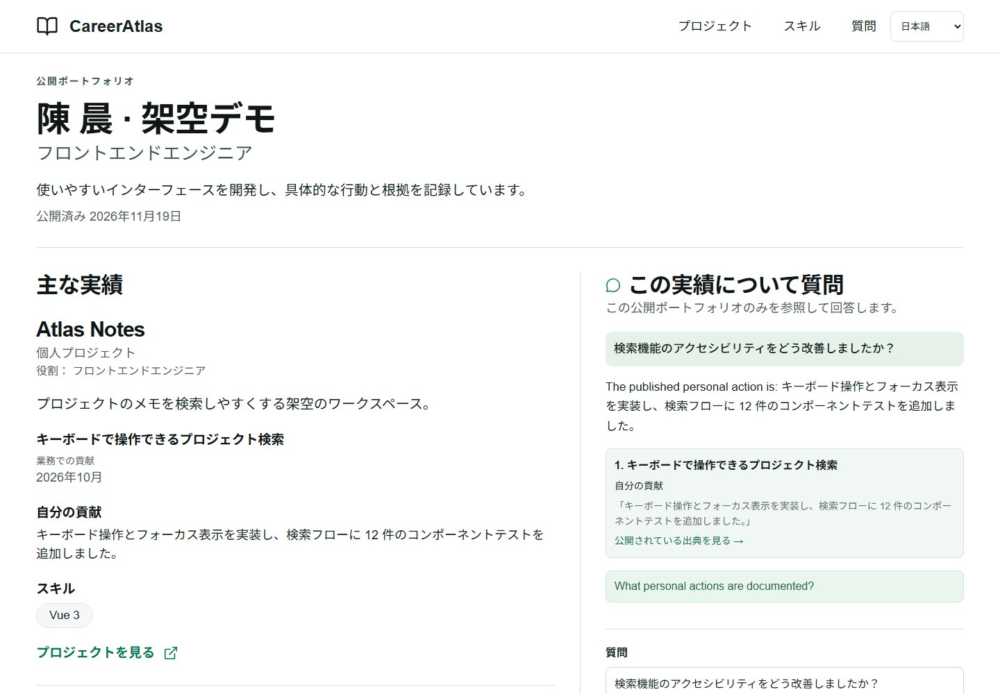

# CareerAtlas

[English](README.md) · [Chinese](README.zh-CN.md) · [Japanese](README.ja.md)

**クイックリンク：** [オンラインドキュメント](https://dax9s3s2t9odi.cloudfront.net/docs/ja/index.html) · [デモのホーム](https://dax9s3s2t9odi.cloudfront.net)

**サンプルポートフォリオ（架空の人物）：** [Nora Bennett · 英語](https://dax9s3s2t9odi.cloudfront.net/p/atlas-eity2sboy0uvrdlhk1gz) · [Evan Reed · 英語](https://dax9s3s2t9odi.cloudfront.net/p/atlas-6tvhkjjvsaiyzcccb878) · [高橋悠人 · 日本語](https://dax9s3s2t9odi.cloudfront.net/p/atlas-dwpjxdazdkl2tssgnriq) · [森川彩 · 日本語](https://dax9s3s2t9odi.cloudfront.net/p/atlas-mafajpuvf0vpcsy2thtg)

**AI Agent と経験を整理し、面接に備え、根拠のあるストーリーを伝える。**

CareerAtlas はプロジェクト、個人の貢献、スキル、根拠を結び付け、**AI Agent が経験の整理、面接準備、出典付きのポートフォリオ Q&A を支援**します。英語・簡体字中国語・日本語に対応しています。

**技術スタック：** PHP 8.3+（**バックエンドフレームワーク：Laravel 13**）· Vue 3 · TypeScript · PostgreSQL。

[AI Agent 入門](docs/ja/ai-agent.md) · [利用ガイド](docs/ja/index.md) · [クイックスタート](docs/ja/quickstart.md) · [開発ガイド](docs/ja/development.md)

## Laravelで実装している機能

PHP 8.3+（**バックエンドフレームワーク：Laravel 13**）で、以下の業務処理を実装しています。

- ユーザー認証、セッション、所有者ごとのデータアクセス制御。
- プロフィール・プロジェクト・経験・スキル・根拠の登録と更新。
- 入力検証、データベーストランザクション、更新時のバージョン確認。
- 明示的な確定、選択項目の公開スナップショット作成、公開取り消し。
- キューによるAI処理、参照範囲の制限、確認後の提案適用。
- 業務フロー、アクセス制御、異常系に関する自動テスト。

Vue画面と開発者向けMCPは、共通のLaravel業務処理を利用します。[バックエンドの実装とコード案内](docs/ja/backend.md)で、実際のコードと設計理由を説明しています。

## 設計・仕様ドキュメント

以下の説明文書は、このGitHubリポジトリ内に含まれています。アプリを起動しなくても閲覧できます。

| 確認したい内容 | ドキュメント |
| --- | --- |
| 製品の範囲、実装済み機能と今後の計画 | [機能一覧](docs/ja/roadmap.md) |
| 画面と操作フロー | [画像付き利用ガイド](docs/ja/index.md) |
| 全体構成とLaravelの実装 | [技術構成](docs/ja/architecture.md) · [バックエンド](docs/ja/backend.md) |
| DBの関係、確定と公開の流れ | [データモデルとライフサイクル](docs/ja/data-model.md) |
| アクセス制御とAIの参照範囲 | [プライバシーとAI](docs/ja/privacy-and-ai.md) |
| HTTP操作と開発者向け連携 | [APIとMCP](docs/ja/mcp.md) |
| テスト範囲、期待結果、再現方法 | [テストと検証](docs/ja/testing.md) |
| インストールと動作環境 | [ローカル開発](docs/ja/development.md) |

確認の順序：上のオンラインサンプルをログインせずに開き、プロジェクトと根拠を確認した後、バックエンド、データモデル、テストの説明をご覧ください。サンプルの人物と成果は架空です。AIの利用可否は実行環境の設定によりますが、公開情報の閲覧にはモデルは不要です。

## AI Agent でできること

- **整理と準備**：メモを編集可能な経験の下書きにし、要件と選択した根拠を対応付け、回答作成や文章での練習を支援します。
- **紹介と説明**：機会別の紹介文や確認用の翻訳を作成し、訪問者の質問にクリック可能な出典を付けて答えます。
- **判断は本人が**：Agent は選択した情報源の範囲で動き、確認・確定・公開は本人が行います。有効化は運用設定によります。手動操作も利用できます。



*架空データと固定出力のテスト提供元を使った実画面です。操作の流れを示し、実際のモデル品質は示しません。[AI Agent の使い方へ](docs/ja/ai-agent.md)。*

## できること

- **記録**：プロジェクトを整理し、個人の行動とチームの成果を分け、スキル・根拠・変更履歴を残します。
- **整理**：メモを保存し、任意の AI 下書きと重複候補を確認して、自分で経験を確定します。
- **準備**：情報源を選び、回答とバージョンを管理し、文章で練習して有用なフィードバックを保持します。
- **共有**：選択項目をプレビューし、引用付き Q&A のあるポートフォリオを公開・取り消しできます。
- **調整**：応募機会ごとに独立したページを作り、確認済み Markdown を出力します。翻訳も選べます。

P0 と P1 は実装済みです。組織、指定相手へのアクセス許可、第三者による確認は計画中です。AI が確定・公開を代行することはなく、モデルなしでも手動操作できます。[プライバシーと現在の制限](docs/ja/privacy-and-ai.md)。

## 使い方

1. ホームで**ログイン**を選び、必要ならアカウントを作成します。
2. プロジェクトと経験を追加し、根拠を付けて事実を確定します。
3. [AI Agent のチュートリアル](docs/ja/ai-agent.md)で回答を作るか、公開ポートフォリオの引用付き Q&A を試します。共有前に下書きを自分で確認・確定します。

[画像付きガイド](docs/ja/index.md)に、全フロー、問題からの復旧、3 言語の実画面をまとめています。

## 技術構成

| 層 | 技術と役割 |
| --- | --- |
| 画面 | Vue 3、TypeScript、Vite、Vue I18n |
| アプリ | PHP 8.3+（バックエンドフレームワーク：Laravel 13）、共通 HTTP/MCP 操作、サーバー側の認可 |
| データ・AI | PostgreSQL、バージョン付き公開スナップショット、DB キュー、制限付きモデルアダプター |
| 文書 | VitePress、静的ページとローカル検索、アプリと一緒に配布 |

[構成とコードの場所](docs/ja/architecture.md) · [API と MCP](docs/ja/mcp.md)。正確な依存バージョンはロックファイルを参照してください。

## ローカル起動

PHP 8.3+、Composer 2、Node.js 22+、PostgreSQL 16+ が必要です。クローン後、リポジトリ直下の POSIX shell で実行します。DB とロールを先に作り、環境ファイルのコピーとキーの生成は初回だけ行ってください。

```sh
composer install
npm ci
cp .env.example .env
php artisan key:generate
# Configure a PostgreSQL database and its credentials in .env first.
php artisan migrate
npm run build
php artisan serve --host=127.0.0.1 --port=8000
```

`http://127.0.0.1:8000` を開きます。AI は既定で無効です。[詳しい開発ガイド](docs/ja/development.md)に PHP 拡張、Windows/WSL、ワーカー、スケジューラー、隔離テスト DB の設定があります。

## 開発と貢献

`npm run dev` で製品 UI をホットリロードし、`npm run docs:dev` で文書をプレビューします。`npm run build` は両方をビルドします。`npm run test:i18n`、`npm run test:docs` と、独立したローカルテスト DB 上の関連 PHP・ブラウザーテストで検証してください。

[AGENTS.md](AGENTS.md) と[技術ナレッジベース](.github/KnowledgeBase/Index.md)を読み、目的を絞ったプルリクエストに検証結果を添えてください。秘密情報、実際の職務記録、`.local/` は Git に入れません。[架空ケース集](examples/case-library/README.md)にはポートフォリオの例と任意の導入手順があります。
