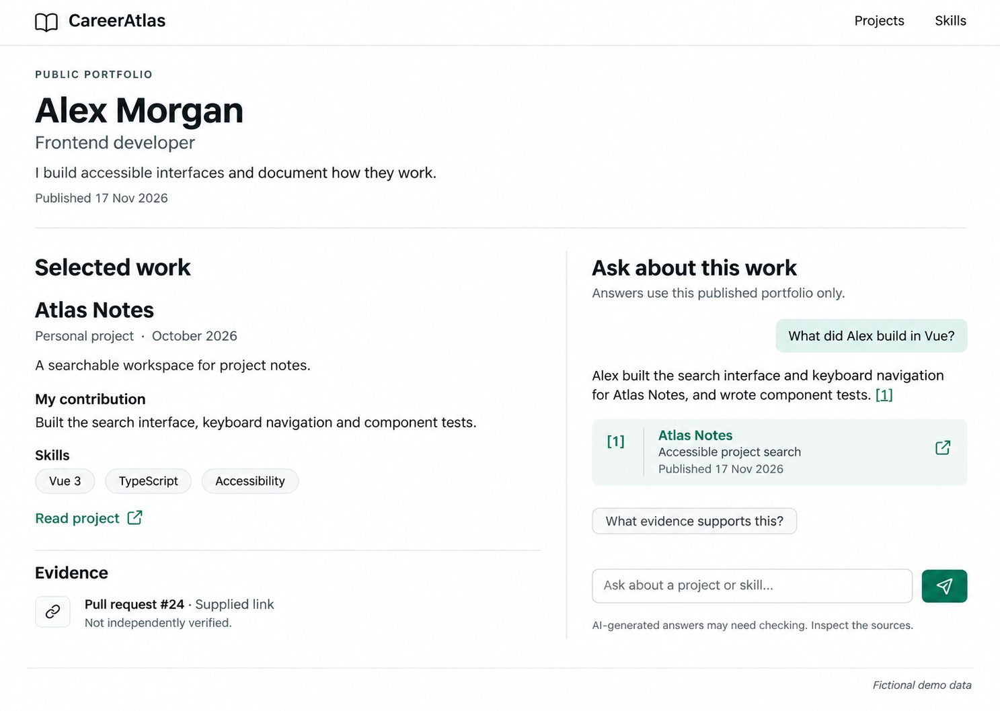

# CareerAtlas

[English](README.md) | [Chinese](README.zh-CN.md) | [Japanese](README.ja.md)

**An AI-powered career portfolio and skills knowledge system that connects personal experience, project demonstrations, contributions, and evidence, and makes authorized records searchable through conversation.**

CareerAtlas is a standalone product for individuals and organizations. It helps people document their work, present their capabilities, and prepare for opportunities. Future organization features help employees share experience and support development conversations. These documents define the product, architecture, delivery roadmap, and engineering workflows.

## Project status

The P0 application now includes the owner workspace, public portfolio, developer MCP tools and a bounded, source-cited public assistant. Local acceptance is recorded in the [ten-gate implementation ledger](.github/TaskLogs/2026-11-18-p0-implementation.md). P1/P2 features remain planned; no cloud deployment is claimed.

## Technology direction

- PHP / Laravel: authentication, authorization, validation, business logic, APIs, and agent tools.
- Vue 3 / TypeScript: editing, portfolio presentation, and conversational interfaces.
- Vue I18n: English, Simplified Chinese, and Japanese interface catalogs.
- PostgreSQL: structured career records, publication snapshots, and references.
- Model provider adapter: bounded tool calling and structured answers through a server-side integration.
- Deployment: a configurable application runtime, persistent PostgreSQL, HTTPS delivery, and recoverable releases.

Lockfiles record the exact runtime dependencies. [Building and verification](.github/Guidelines/Building.md) covers database setup, assets, web/queue processes and tests. Actual hosting services, model subscriptions, and environment settings belong to local operations documentation. See [Deployment contract](.github/KnowledgeBase/KB_CareerAtlas_Design_Deployment.md).

## Public and local documentation

Git-tracked root documents, `.github/`, and `design/` form the shared documentation intended for GitHub: requirements, technology choices, architecture, implementation contracts, engineering standards, reusable development tasks, and UI/UX product design references.

`.local/docs/` is the ignored local companion for a particular demo: actual cloud/API services, environment restrictions, quotas, credential locations, and deployment troubleshooting. Start with its `README.md` when working on that environment. It is intentionally absent from a fresh clone; shared documentation must remain usable without it. Never put secret values in either documentation set. See [Documentation](.github/Guidelines/Documentation.md) for the ownership rules.

## Languages

Use the language selector on the sign-in page, in the workspace, or on a public portfolio to switch between English, Simplified Chinese, and Japanese. The interface follows a saved browser preference first, then the browser language, with English as the fallback. Switching preserves unsaved form input and conversation history. Profile language is separate from interface language.

Navigation, forms, confirmation dialogs, validation and recovery messages, assistant controls, accessibility labels, dates, and counts are localized. User-authored records, source quotations, and previous AI answers remain in their original language. New AI answers follow the question's language; translated question suggestions provide a starting point. Translation does not grant additional access or change publication snapshots.

The three READMEs cover the same product overview. Engineering documentation remains in English. See the [localization contract](.github/KnowledgeBase/KB_CareerAtlas_Localization.md) for catalogs, API behavior, maintenance, and verification.

## Start here

- [Project objective and scope](Project.md)
- [AI agent entry point](AGENTS.md)
- [Repository instructions](.github/copilot-instructions.md)
- [Knowledge base and functional specifications](.github/KnowledgeBase/Index.md)
- [Implementation backlog](.github/TaskLogs/Copilot_Scrum.md)
- [Documentation provenance](.github/KnowledgeBase/Sources.md)

## Product design references

The UI/UX suite defines the private contribution editor, explicit publication preview and public portfolio with source-cited answers. These original fictional mockups remain the visual references for the implemented screens; they are not screenshots of a deployed service.



- [Design pack: three UI mockups and four UX flows](design/2026-11-17/README.md)
- [UI framework, screen specifications, and requirement mapping](.github/KnowledgeBase/KB_CareerAtlas_Design_UIUX.md)
- [Page states and interaction requirements](.github/KnowledgeBase/KB_CareerAtlas_Design_UserExperience.md)

The static `design/2026-11-17/index.html` gallery can be opened after cloning. The Markdown design pack is the GitHub-readable entry point; publishing these files does not deploy a website.

## Documentation workflow

This repository adapts GacUI's documentation organization: root instructions, a knowledge-base index, focused guidelines, workflow prompts, task logs, and learning records. Working documentation is in English; the Chinese and Japanese READMEs are explicit reader-facing translations.

Typical workflow commands for a coding assistant:

```text
ask Explain the publication and revocation rules.
design Plan the first P0 implementation slice.
plan Break the design into implementation steps and tests.
summarize Prepare the execution checklist.
execute and verify
kb Record the implemented design and verified commands.
```

Natural-language requests also work. A request to write documentation does not authorize application implementation or deployment.

## Validate documentation

Run from PowerShell:

```powershell
& './.github/Scripts/Validate-Documentation.ps1'
```

Run from the repository root. The script checks local Markdown links, required files, requirement identifiers, workflow markers, the public/local documentation boundary, and an English-baseline character guard with an explicit exception for the translated READMEs. It does not check external URLs, heading anchors, or application behavior.
