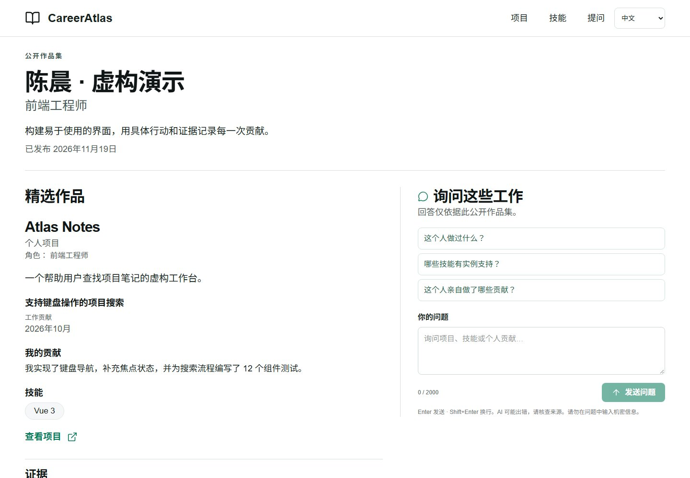

# CareerAtlas

[English](README.md) · [Chinese](README.zh-CN.md) · [Japanese](README.ja.md)

**记录工作，用证据准备面试，分享适合当前机会的经历。**

将项目、个人贡献、技能与证据连接起来的职业工作区，提供可选的来源驱动 AI 辅助，内置英语、简体中文与日语。

[使用指南](docs/zh-CN/index.md) · [快速上手](docs/zh-CN/quickstart.md) · [开发指南](docs/zh-CN/development.md) · [功能全览](docs/zh-CN/roadmap.md)



*实际应用截图，内容均为虚构数据。线上产品首页直接链接到同一套三语指南。*

## 可以做什么

- **记录：**整理项目，区分个人行动与团队成果，关联技能和证据，保留修订历史。
- **采集：**保存笔记，检查可选 AI 草稿和重复候选，再自行确认生成的经历。
- **准备：**选择来源、起草与管理回答版本，进行文字练习并保留有用反馈。
- **分享：**预览选中字段，发布支持引用问答的作品集，并可撤销访问。
- **定制：**为机会创建独立页面，导出经过检查的 Markdown，也可选择翻译。

P0 与 P1 已实现。组织、指定接收人授权和他人确认仍在规划中。AI 不会替你确认或发布；没有模型提供方时仍可手动操作。[隐私与当前限制](docs/zh-CN/privacy-and-ai.md)。

## 如何使用

1. 在首页点击**登录**，需要时创建账号。
2. 添加项目和经历，关联证据并确认事实。
3. 准备面试回答，或者选择公开字段，检查预览后发布。

[图文指南](docs/zh-CN/index.md)涵盖完整流程、异常恢复和三语实际截图。

## 技术架构

| 层级 | 技术与用途 |
| --- | --- |
| 界面 | Vue 3、TypeScript、Vite、Vue I18n |
| 应用 | Laravel 13 / PHP 8.3+，共用 HTTP/MCP 操作与服务端权限 |
| 数据与 AI | PostgreSQL、版本化发布快照、数据库队列、有边界的模型适配器 |
| 文档 | VitePress，静态页面与本地搜索，随应用部署 |

[架构与代码导航](docs/zh-CN/architecture.md) · [API 与 MCP](docs/zh-CN/mcp.md)。准确依赖版本以锁文件为准。

## 本地运行

需要 PHP 8.3+、Composer 2、Node.js 22+ 和 PostgreSQL 16+。克隆仓库后，在根目录使用 POSIX shell 执行下列命令。先创建数据库和角色；只在首次设置时复制环境文件、生成应用密钥。

```sh
composer install
npm ci
cp .env.example .env
php artisan key:generate
# Configure a PostgreSQL database and its credentials in .env first.
php artisan migrate
npm run build
php artisan serve --host=127.0.0.1 --port=8000
```

打开 `http://127.0.0.1:8000`，AI 默认关闭。[完整开发指南](docs/zh-CN/development.md)包含 PHP 扩展、Windows/WSL、队列、调度器和隔离测试库的设置。

## 开发与贡献

`npm run dev` 启动产品热更新，`npm run docs:dev` 预览文档，`npm run build` 同时构建两者。执行 `npm run test:i18n`、`npm run test:docs`，并在独立本地测试库上运行相关 PHP/浏览器测试。

先阅读 [AGENTS.md](AGENTS.md) 和[工程知识库](.github/KnowledgeBase/Index.md)。提交聚焦的拉取请求并附验证结果。密钥、真实经历及 `.local/` 不应进入 Git。[虚构案例库](examples/case-library/README.md)提供作品集示例与可选导入说明。
