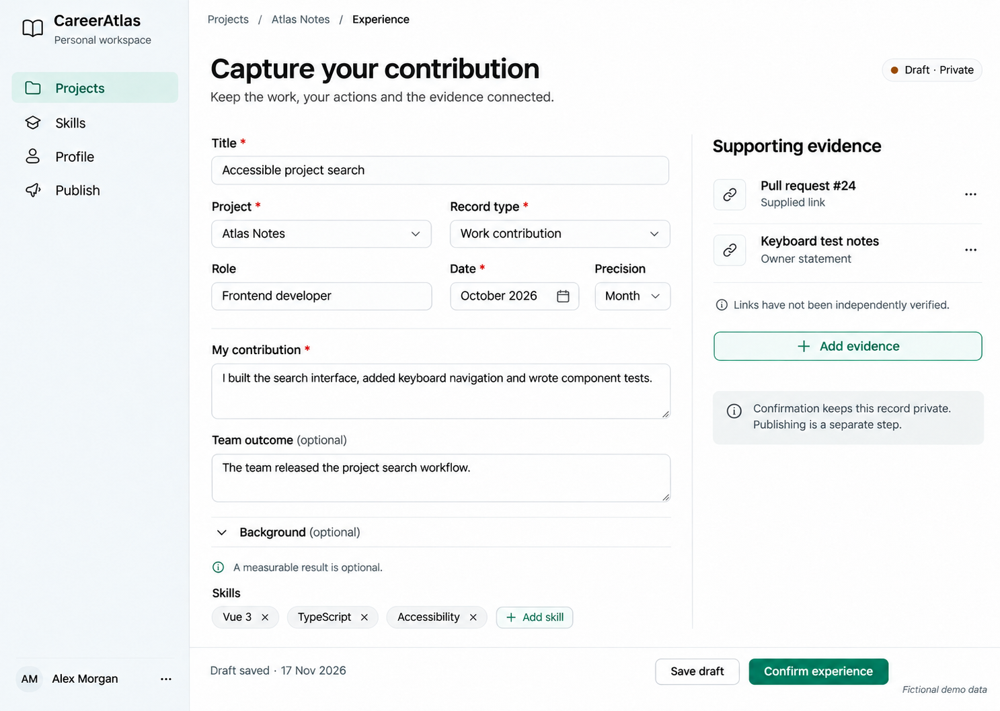
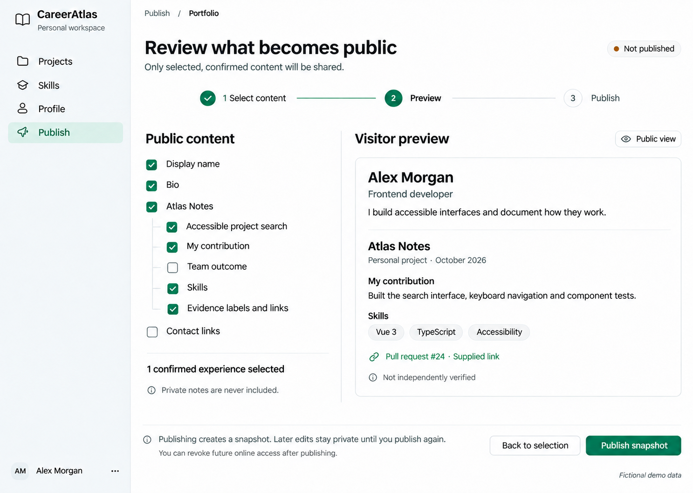
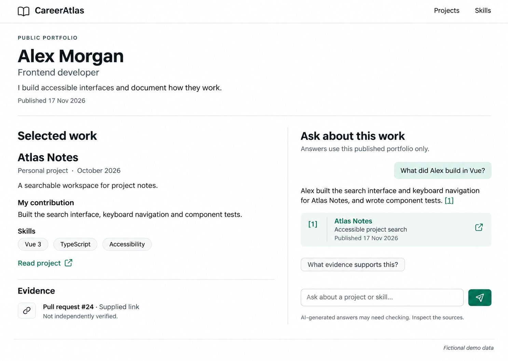
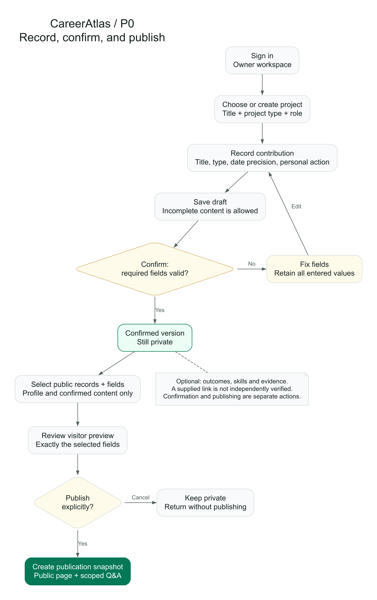

# CareerAtlas UI / UX Design Pack

2026-11-17. Design artifacts only. No application scaffolding, deployment or real career data.

Start with the [review gallery](index.html) or [framework and design specification](../../.github/KnowledgeBase/KB_CareerAtlas_Design_UIUX.md).

## Selected direction

Vue 3 + TypeScript + shadcn-vue + Tailwind CSS. Prefer the official Laravel Vue starter and Inertia at bootstrap; runtime versions and initial UI locale remain open. The visual direction is a quiet white/emerald evidence workspace with a matching public reading surface.

The three images are consecutive screens in one suite, not three competing themes. They illustrate one fictional project and owner. The public sample excludes team outcome and contact links. UI labels are English for this design pass, following repository conventions.

## Final UI mockups

1. [Experience editor](mockups/01-experience-editor.png): private draft, precise occurrence date, separate personal contribution, evidence provenance, explicit confirmation.
2. [Publication preview](mockups/02-publication-preview.png): selected fields, exact visitor scope, explicit publication. This is the corrected final version with Team outcome unchecked.
3. [Public portfolio and cited Q&A](mockups/03-public-portfolio.png): readable contribution and numbered source links within the selected publication.

Target design viewport: 1440 x 1024. Actual raster dimensions are in [asset-manifest.json](asset-manifest.json); ImageGen may use a nearby aspect ratio. These images are visual targets, not coded screens or tested responsive layouts. Mobile behavior and all other P0 screen states are specified in the design document.

## UI preview

### Private contribution editor



### Explicit publication preview



### Public portfolio and cited answers



## UX diagrams

| Flow | View | Editable source |
| --- | --- | --- |
| P0 record, confirm and publish | [SVG](flows/01-record-publish.svg) / [PNG](flows/01-record-publish.png) | [DOT](flows/01-record-publish.dot) |
| P0 visitor questions and citations | [SVG](flows/02-visitor-questions.svg) / [PNG](flows/02-visitor-questions.png) | [DOT](flows/02-visitor-questions.dot) |
| P0 source updates and revocation | [SVG](flows/03-update-revoke.svg) / [PNG](flows/03-update-revoke.png) | [DOT](flows/03-update-revoke.dot) |
| P1/P2 planned workflows | [SVG](flows/04-later-phases.svg) / [PNG](flows/04-later-phases.png) | [DOT](flows/04-later-phases.dot) |



The diagrams explain user actions and product states. They are not infrastructure diagrams. Later-phase flows do not authorize implementing those features in P0.

## Reference captures

- [shadcn-vue component surface](references/shadcn-vue.jpg), captured from [official site](https://www.shadcn-vue.com/).
- [shadcn-vue dashboard](references/shadcn-dashboard.jpg), captured from [official block](https://www.shadcn-vue.com/view/dashboard-01).
- [Shadcn Admin](references/shadcn-admin.jpg), captured from [live demo](https://shadcn-admin.netlify.app/); [open-source repository](https://github.com/satnaing/shadcn-admin). This reference uses React, while CareerAtlas remains Vue.

The screenshots were inspected and supplied to ImageGen for visual grounding. They are reference material, not CareerAtlas screens. No analytics widgets, personal data, or reference branding should be copied into the product.

## Generation and reproduction

Mockups use the built-in ImageGen tool. The exact generation and targeted correction prompts are in [generation-prompts.json](generation-prompts.json). The initial editor and publication images were refined to distinguish Record type from Project type and make publication selection match its preview. Only the final images are in the mockups directory.

Diagrams use local Graphviz through `@viz-js/viz` 3.31.0 and Sharp for PNG export. These are documentation tools installed outside the application repository. To reproduce with a separate tooling directory that contains those packages:

```powershell
node .\render-diagrams.cjs 'path-to-documentation-tooling'
```

Open [index.html](index.html) directly in a browser. It is a static artifact gallery, with image and document links only; it does not simulate product actions or make network requests.

## Review boundaries

The final raster mockups were visually inspected for hierarchy, readable labels and requirement consistency. DOT rendering and local asset/link integrity were checked. The repository documentation validator was run. This is not evidence of implemented authentication, authorization, accessibility, mobile behavior, application tests, or live model evaluation.
