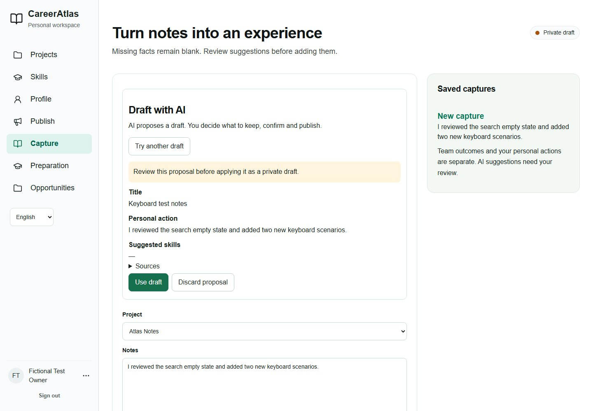
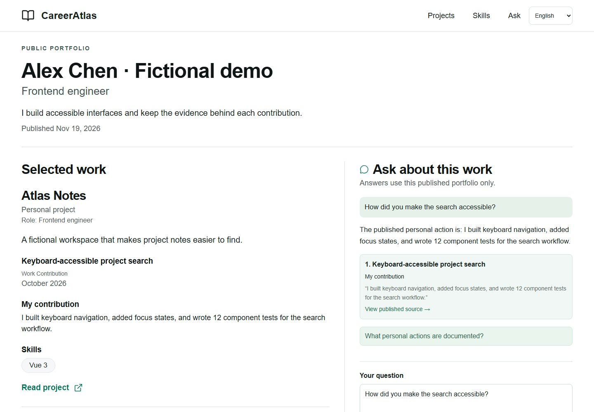

# AI Agent walkthrough

**Turn your notes into a career story, then let visitors explore the evidence through conversation.** CareerAtlas provides owner-side AI assistance and a separate, source-cited portfolio Agent.

## Choose a starting point

| Your goal | Where to start | What the Agent does |
| --- | --- | --- |
| Organize a contribution | **Capture** → **Draft with AI** | Proposes editable facts and optional follow-up questions |
| Prepare for an interview | **Preparation** → selected sources → AI actions | Maps requirements, drafts answers, and reviews written practice |
| Tailor an application | **Opportunities** → AI actions | Maps evidence, drafts an introduction, or proposes an export translation |
| Understand a portfolio | Public page → **Your question** | Answers within that publication and cites the supporting records |

For a new account, complete [first-time setup](./quickstart.md). AI controls are available only when the operator enables the corresponding owner or publication; enabling one does not enable the other. For local configuration, see [development](./development.md).

## 1. Capture an experience with the Agent

1. Sign in, create a project, then open **Capture** and select that project.
2. Write the facts in **Notes** and save. For example: “I added keyboard navigation and wrote 12 component tests for project search.” Use your own facts when creating a real record.
3. Choose **Draft with AI**. Inspect the proposed title, personal action, sources, and any follow-up questions. Supply missing facts or skip questions you cannot answer.
4. Choose **Use draft**, edit the fields, and save. Review possible duplicates before adding or merging an experience.
5. Open the resulting experience, attach relevant skills/evidence, and explicitly confirm it. Applying a proposal does not confirm the record.

*Actual application UI with fictional data and a deterministic test-provider draft. The example illustrates review and application, not live model quality.*

## 2. Prepare an answer from your evidence

In **Preparation**, enter a topic and requirements, select confirmed experiences, and choose the target content language. Save the brief before requesting AI assistance. Review the requirements/evidence mapping, then enter a question such as “What did you personally contribute?” and request an answer draft.

Check that the answer preserves your responsibilities, actions, results, and source references. Apply it to the editor, revise it, save, and confirm it yourself. In written practice, save an attempt before requesting feedback; retaining feedback and retaining the session are separate actions. [Full preparation workflow](./preparation.md).

For an opportunity-specific introduction or export translation, follow the same **select sources → generate → review → explicitly apply** sequence. Review translated fields against the source before downloading. [Opportunities and export](./opportunities.md).

## 3. Let visitors ask the portfolio Agent

Choose confirmed records and public fields, review the preview, and publish. Open the public page; visitors do not need an account. When public Q&A is enabled:

1. Select a suggested question or type one in **Your question**, such as “What did this person build?”
2. Submit the question and read the answer. You can cancel a running request.
3. Open a citation to inspect the supporting source. The Agent only sees this page's permitted records; it should acknowledge missing evidence.

*The pictured answer uses a deterministic test provider. Fixed wording demonstrates the citation workflow, not language quality or live model performance.*

Public Q&A follows the question's language. Owner drafts and export translations use the chosen content language. Switching the interface language does not translate saved records or earlier answers.

## Review, retry, or continue manually

You control which facts are retained, confirmed, and published. The Agent cannot publish or send an application for you. If a source changes, refresh it and review a new proposal. If assistance is unavailable or cancelled, continue editing or browsing manually.

This guide concerns the product's AI features. Developer MCP access is a separate authenticated integration: see [API and MCP](./mcp.md). Read [privacy and source boundaries](./privacy-and-ai.md) for what each Agent can access.
