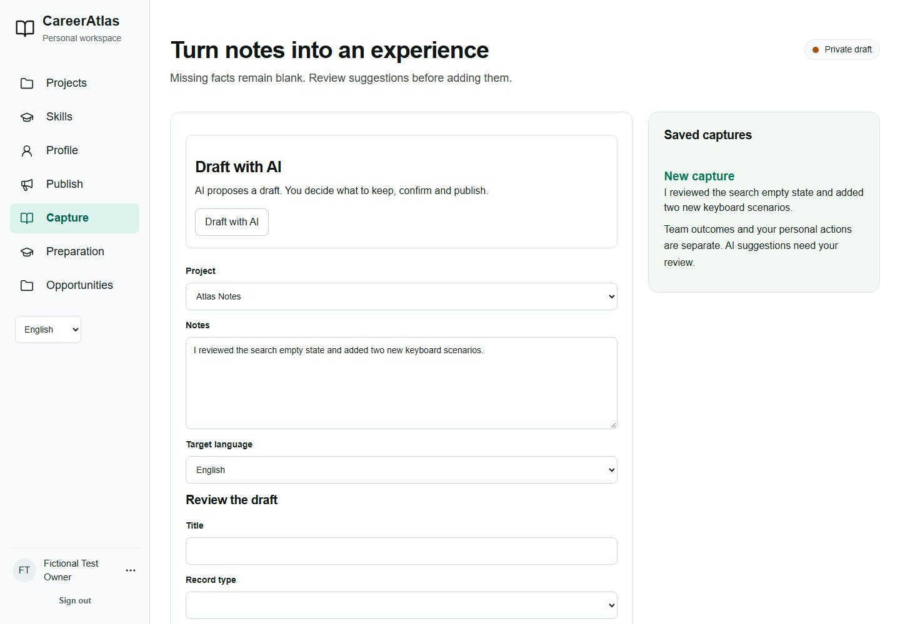
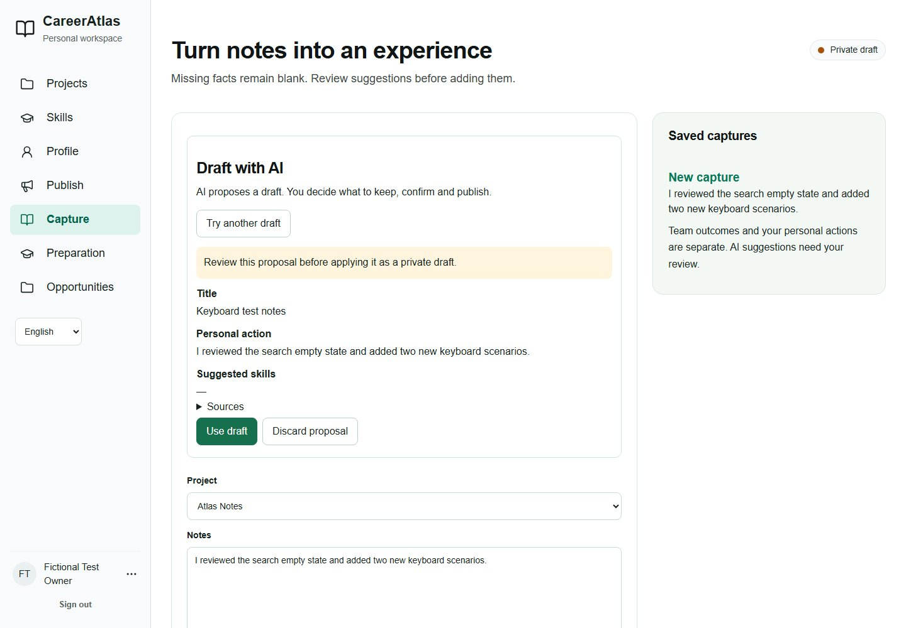
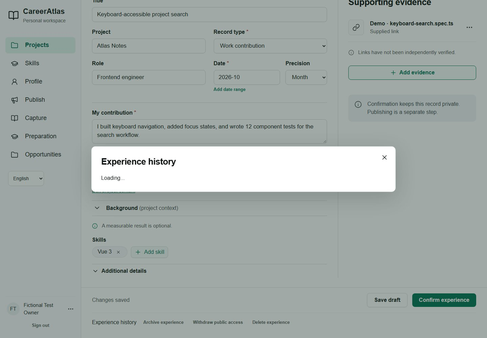

# Capture and revision history

Use **Capture** to save raw notes before turning them into a structured experience.

## Save and review notes

1. Choose a project, enter notes, and save. You can reopen the saved capture later.
2. Fill the structured title and personal action manually. If enabled, choose **Draft with AI**, review the proposed facts and optional follow-up questions, then use or discard the draft. Missing facts should remain questions; you can skip them.
3. Save the edited notes and choose **Review duplicates**. Compare suggested matches; similarity does not prove that two records are the same.
4. Choose **Add as new experience**, or merge into the selected existing experience after checking its version. Open the resulting experience and confirm it separately.

Applying an AI proposal does not confirm or publish anything. Review suggested skills before applying them. A source changed in another tab can invalidate a proposal or merge; reload the current source and review again rather than overwriting it.

*This screenshot uses the deterministic test provider to demonstrate review controls. Its fixed example output does not demonstrate a live model's language or answer quality.*

## Inspect changes

Open an experience and choose **Experience history** to see versions and field differences. This owner-only view helps distinguish original facts, later corrections, and confirmed versions. Prepared answers have their own **Answer history** in [Preparation](./preparation.md).

Publication uses a selected version snapshot. Editing a record does not silently rewrite an already shared page. Review and publish an updated selection when you want visitors to see the change.

If AI is disabled, cancelled, or fails, keep editing manually. Unapplied proposal runs expire after one day; applied drafts are saved records.
