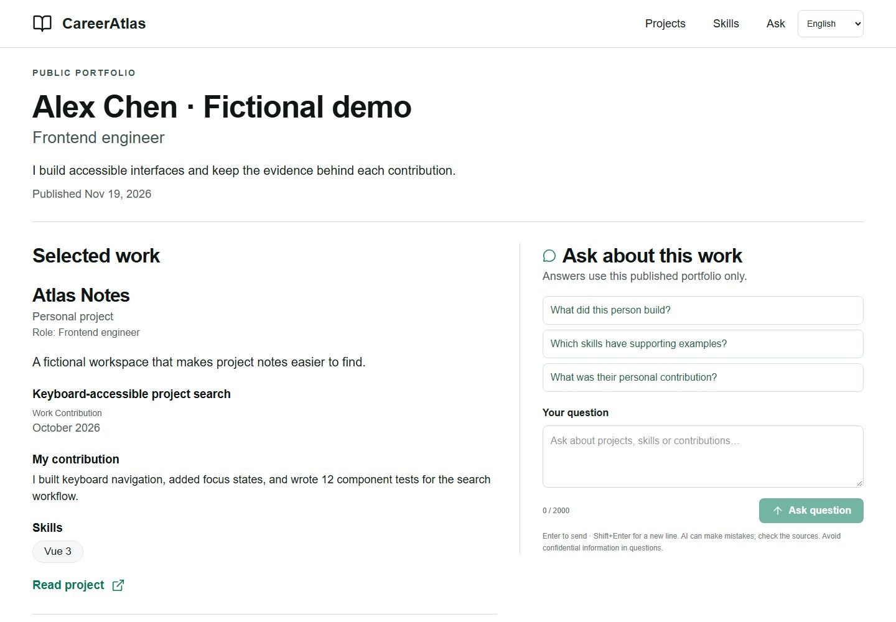

# Your experience, with the evidence behind it

CareerAtlas connects projects, personal contributions, skills, and evidence. Use the same private record to prepare for interviews and publish a selected portfolio.

**[Start in five steps](./quickstart.md)** · **[Run locally](./development.md)** · **[All features](./roadmap.md)**

*Actual application screenshot. All names, records, projects, and evidence links in this guide are fictional demonstration data.*

## Choose your task

| I want to… | Start here |
| --- | --- |
| Document what I did | [Projects, experience, skills, and evidence](./records.md) |
| Turn scattered notes into a record | [Capture and revision history](./capture.md) |
| Prepare and rehearse an interview answer | [Preparation and written practice](./preparation.md) |
| Share a portfolio and answer visitor questions | [Publishing and Q&A](./publishing.md) |
| Tailor a page for one opportunity | [Opportunities and Markdown export](./opportunities.md) |
| Understand what becomes public | [Privacy and AI boundaries](./privacy-and-ai.md) |
| Extend or self-host the application | [Architecture](./architecture.md), [development](./development.md), [API and MCP](./mcp.md) |

## Three languages, one workflow

The application and this guide support English, Simplified Chinese, and Japanese. The language menu switches the current documentation chapter. Product UI language, profile language, and generated-content target language are separate settings. Changing the UI does not translate saved records or previous answers.

The guide covers implemented P0/P1 functionality. Named-recipient grants, organization collaboration, and reviewer confirmation are [planned P2 features](./roadmap.md), not currently available controls. AI availability depends on the operator; manual workflows remain usable without it.
