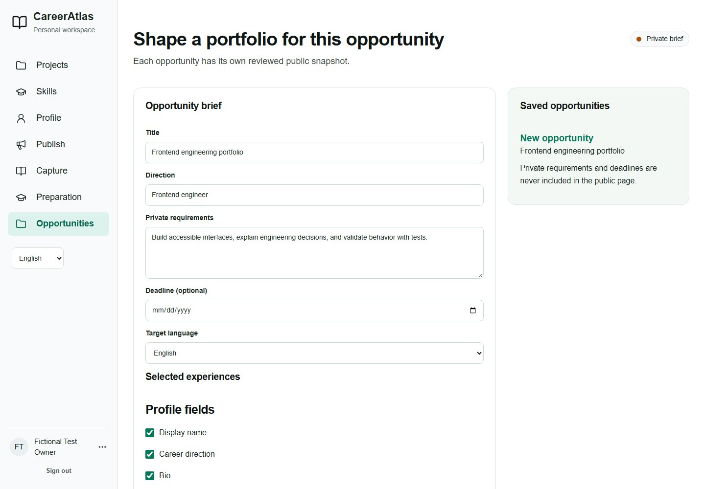
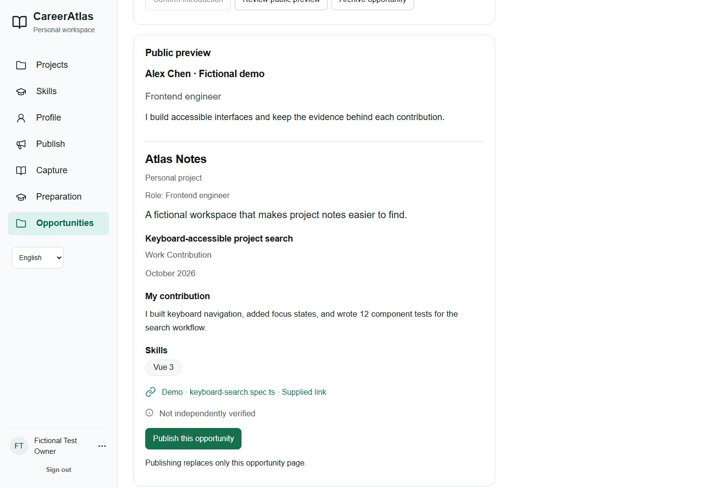

# Opportunities and export

Create a separate portfolio for each application or professional opportunity without exposing the entire archive.

## Write the private brief

In **Opportunities**, enter a title, target direction, requirements, optional deadline, and target language. Select and order confirmed experiences and their public fields. The private brief stays out of the publication.

Optional AI mapping explains relevant evidence and gaps. An introduction can change emphasis, but must preserve source facts. Review, save, and confirm the introduction before including it; applying an AI draft alone is not confirmation.

## Publish an independent page

Choose **Review public preview**, inspect the selected fields and their order, then **Publish this opportunity**. Open the public page to verify it. Each opportunity has its own publication and revocation lifecycle; visitors cannot discover another opportunity through this page's assistant.

Update or revoke this page independently. Source changes can require refreshed selections, confirmation, and a new preview.

## Download Markdown

Use **Download Markdown** to export the authorized selected fields with localized headings and source-version references. For a translated export, request translation when available, inspect each translated field, then acknowledge that you reviewed it against the sources before downloading.

Names, dates, numbers, responsibilities, and provenance must remain accurate. The export is Markdown, not a PDF/resume-layout generator. Revocation affects new online access and exports, but cannot erase downloaded copies. Named recipients and link expiry are [planned](./roadmap.md).
