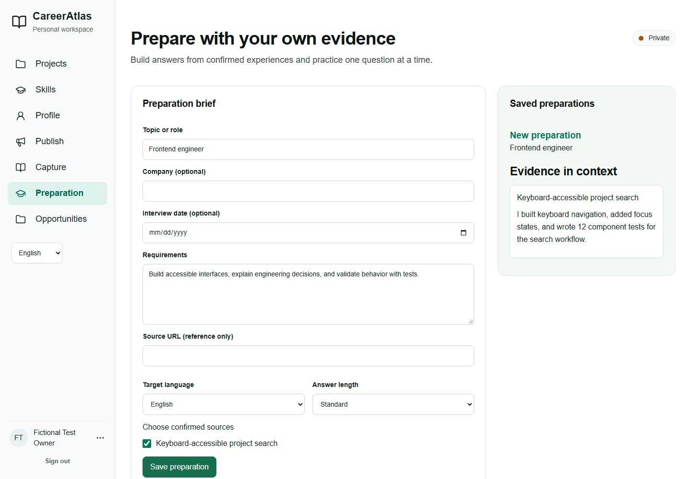
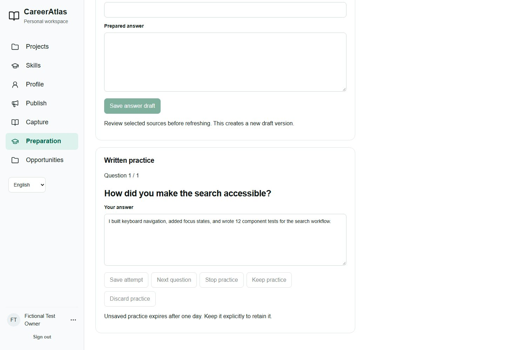

# Interview preparation

## Create a preparation brief

Open **Preparation** and enter a role or topic. Optionally add a company, interview date, requirement text, and source URL. URLs are stored as references, not crawled. Choose confirmed experiences, a target language, and short or standard answer length. Save the brief.

## Build and confirm answers

Enter a question and write an answer, or use the optional AI mapping and answer actions. Review relevance, source citations, gaps, and follow-up questions. Matching percentages are not evidence. Keep your responsibilities and the team's result distinct.

Save an answer draft, edit it, then explicitly confirm it. **Answer history** retains versions and their original source references. Changed or unavailable sources are flagged; refresh sources and review the answer before confirming again. UI language changes do not rewrite your answer. Generated content follows the selected target language.

## Practice one question at a time

1. Enter practice questions, one per line, and start.
2. Type your answer and save the attempt. You can revise an answer and save another attempt.
3. Move to the next question or stop. When available, request feedback on specificity, structure, consistency, and clarity; review it before keeping it.
4. Choose **Keep practice** to retain the session, or discard it. Keeping feedback alone does not retain the practice session.

Unretained practice expires after 24 hours and is removed by scheduled cleanup. Discarded practice does not become an experience. This is text practice: no audio recording, speech scoring, hiring probability, or automated employer evaluation. Length settings are approximate guidance.

AI is optional throughout. Draft, edit, confirm, and practice manually if assistance is unavailable.
