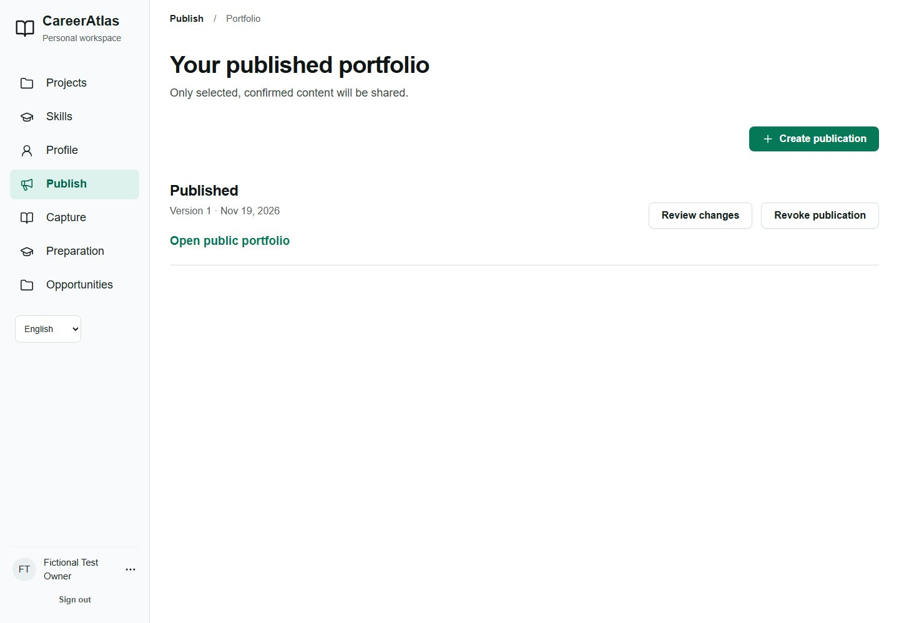
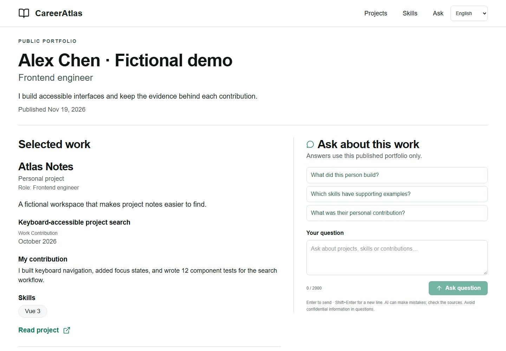
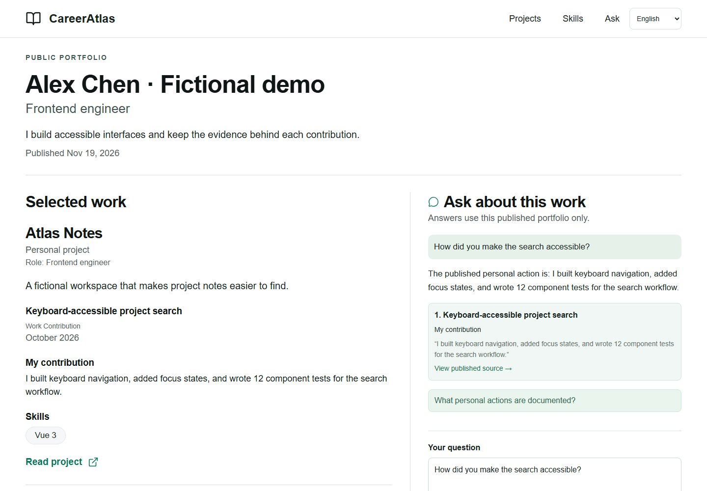

# Publishing and portfolio Q&A

## Select, preview, publish

**Publish** shows confirmed experiences available for sharing. Choose the exact profile fields, project context, and experience fields to include. Review the complete visitor preview before publishing. If the source or selection changes, refresh the preview; the old preview cannot authorize a different publication.

The page is a snapshot, not a live mirror of every private edit. Drafts, private notes, unselected fields, and unrelated opportunities do not enter the public projection. Anyone with a current public link can read it; an opaque URL is not a named-recipient access policy.

## Read and ask questions

Visitors can browse the profile, projects, contributions, skills, and evidence without an account. Project/skill details expose only that page's selected material.

When enabled, the assistant answers questions using only the current publication's permitted sources. Career claims should carry clickable citations that open their source context. Missing information should be acknowledged. A question about hidden records cannot expand the page's access scope.

The visitor can cancel a running request. Provider failures or rate limits leave manual reading available. Public answers follow the question's language; previously saved answers and user-authored records are not automatically translated.

*A deterministic test provider demonstrates the queued answer and citation workflow. Fixed test wording is not a live model-quality or translation evaluation.*

## Update or withdraw

Review a fresh preview and publish explicitly to share updated content. **Revoke** disables the online publication and its assistant access. Source withdrawal also prevents dependent content from continuing to be served. Workspace archiving alone does not revoke a page.

Previously downloaded or copied material cannot be recalled. For separate audiences or applications, create [independent opportunity pages](./opportunities.md); authenticated recipient grants remain planned.
