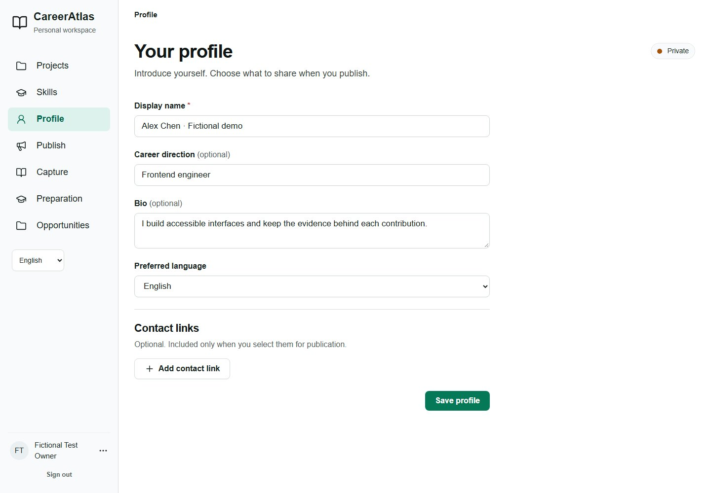

# Quick start

Follow this path to publish one evidence-backed contribution. No AI configuration is needed.

## 1. Sign in and set up your profile

Open the product homepage, choose **Sign in**, and use **Create account** if needed. Registration requires a display name, email, and matching passwords of at least 12 characters. The homepage and documentation are public; the workspace requires a session.

Open **Profile**. Save a display name and optionally your direction, bio, contact links, and preferred content language. A saved contact link is not automatically public.

## 2. Create a project

In **Projects**, add a title, project type, and your role. Add background, dates, and the team's outcome if useful. Approximate dates and ongoing work are supported.

## 3. Record your contribution

Add an experience inside the project. Fill its title, record type, occurrence date, and **Personal action**. Add skills and labeled evidence links. Save a draft while details are incomplete; choose **Confirm experience** after reviewing the facts. Keep your own action separate from the team's overall outcome.

## 4. Preview selected fields

Open **Publish**. Select the confirmed experience and only the profile, project, and experience fields you intend to share. Review the visitor preview; unselected fields and private notes stay outside the public page.

## 5. Publish and inspect

Publish explicitly, open the public link, and check its content. Visitors can read the page without signing in. Q&A appears when enabled by the operator. Revoke the publication when it should no longer be accessible.

Next: [prepare an interview answer](./preparation.md) or [tailor an opportunity page](./opportunities.md). For missing buttons or rejected saves, see [troubleshooting](./troubleshooting.md).
