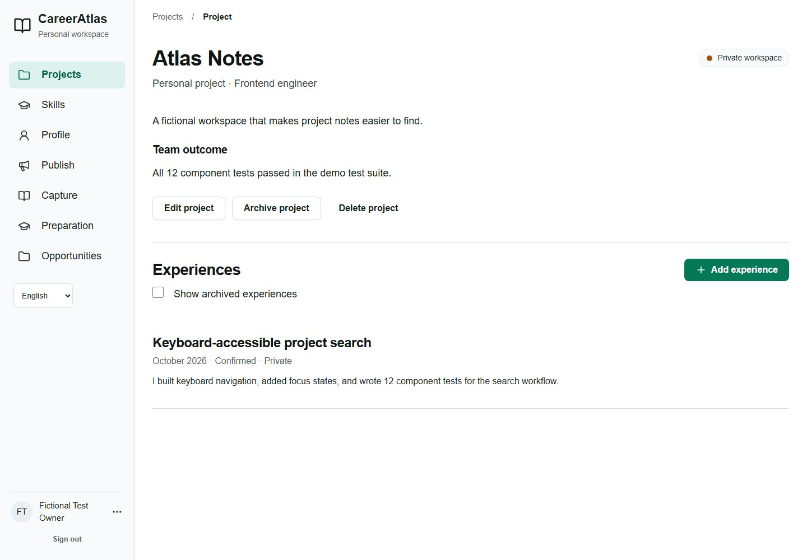
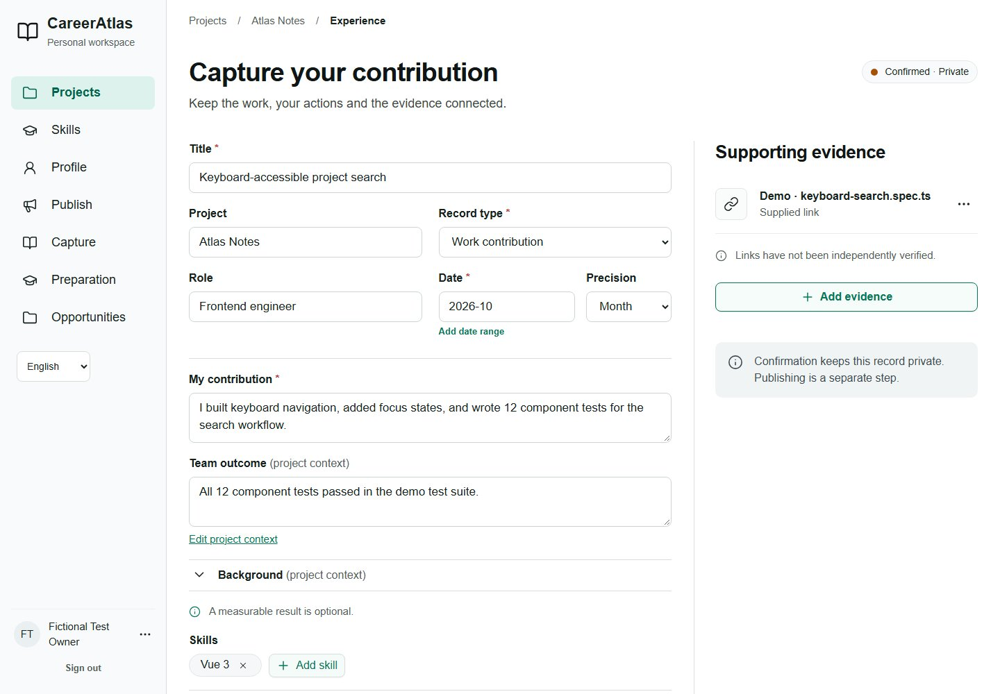
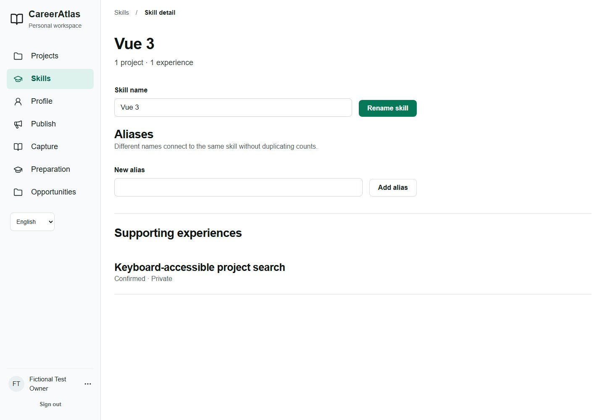

# Projects and experience

## Profile and projects

**Profile** stores your display name, direction, bio, contact links, and preferred language. **Projects** groups related work: commercial, personal, or learning. A project requires a title, type, and role; background, dates, and team outcomes add context. Search the project list and open a project to manage its experiences.

## Experience lifecycle

1. Create a record inside a project. Incomplete information can be saved as a draft.
2. Record your action, result, validation, and remaining work. Dates support year/month/day precision; do not invent precise dates.
3. Add skills and evidence, review the fields, then confirm. Confirmation requires a title, project, record type, occurrence, and personal action.
4. Edit when facts change; the saved version and confirmation state determine what can be published. Confirm the updated draft and review a new publication preview.

Your **personal action** describes what you did. A **team outcome** describes the group's result; it is not proof that you performed every part. **Private notes** are owner-only and excluded from public projections.

Archive/restore controls organize your workspace. Archiving is not a substitute for revoking a publication. Deletion and source withdrawal can make dependent public content unavailable; review the confirmation dialog before proceeding. [Revision history](./capture.md) preserves the record of changes.

## Skills and aliases

Create skills, attach/detach them on experiences, and open a skill to see linked work. Rename a skill or add/remove aliases to normalize naming. Counts deduplicate linked records and projects. Public counts include only material permitted by that publication, not your private archive.

## Evidence

Attach a typed, labeled URL, such as a repository or demo. A link is supplied evidence, not independent verification. Links are not automatically crawled or executed. Owner statements and future reviewer confirmations must not be presented as equivalent. Edit or remove evidence through the experience; recheck the public preview after a source change.
