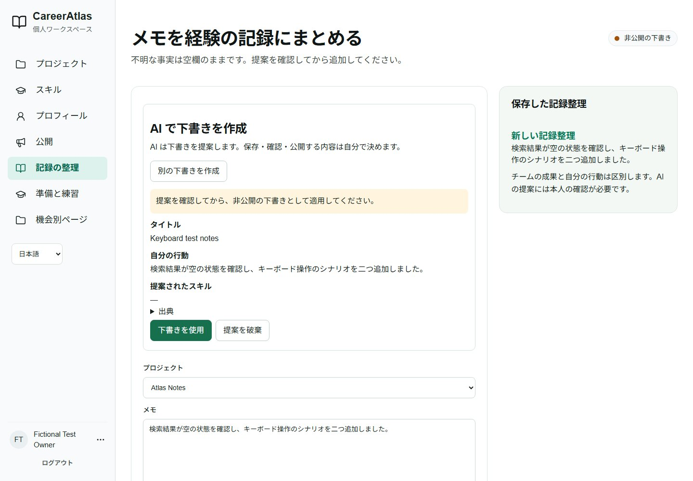
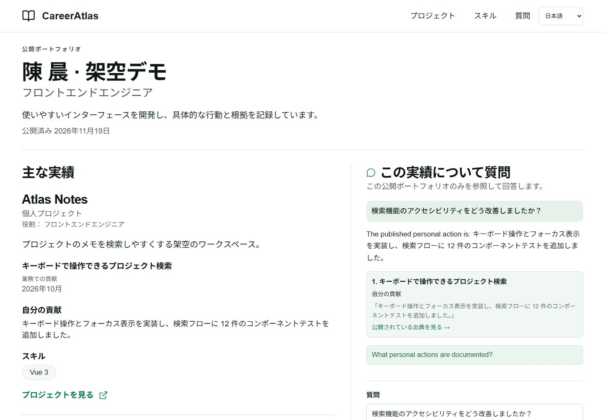

# AI Agent 入門

**メモを経験のストーリーに整理し、訪問者が対話で根拠を確認できるようにします。** CareerAtlas は本人向けの AI 支援と、独立した出典付きポートフォリオ Agent を提供します。

## 始める場所を選ぶ

| 目的 | 入口 | Agent の支援 |
| --- | --- | --- |
| 貢献を整理する | **記録の整理** → **AI で下書きを作成** | 編集できる事実と任意の追加質問を提案 |
| 面接に備える | **準備と練習** → 情報源を選択 → AI 操作 | 要件の対応付け、回答作成、文章練習のフィードバック |
| 応募用の資料を調整する | **機会別ページ** → AI 操作 | 根拠の対応付け、紹介文、確認用の翻訳を提案 |
| ポートフォリオを理解する | 公開ページ → 質問欄 | その公開範囲で回答し、根拠の記録を引用 |

新しいアカウントでは[初回の設定](./quickstart.md)を済ませてください。AI は運用者が対象の本人・公開ページに対して有効にした場合に利用できます。二つの許可は独立しています。セルフホストの設定は[ローカル開発](./development.md)を参照してください。

## 1. Agent と経験を整理する

1. ログインしてプロジェクトを作り、**記録の整理**で対象プロジェクトを選びます。
2. メモに事実を入力して保存します。例：「プロジェクト検索にキーボード操作を実装し、コンポーネントテストを 12 件追加した」。実際の記録では自分の事実を使ってください。
3. **AI で下書きを作成**し、提案されたタイトル、自分の行動、情報源、追加質問を確認します。不明な事実を補い、答えられない質問はスキップできます。
4. **下書きを使用**して項目を編集し、保存します。重複候補を確認してから、経験の追加・統合を選びます。
5. 作成した経験を開き、関連スキルと根拠を付けて自分で確認・確定します。提案の適用だけでは記録は確定されません。

*架空データと固定出力のテスト下書きを使った実画面です。確認・適用の操作を示し、実際のモデル品質は示しません。*

## 2. 根拠から回答を準備する

**準備と練習**でテーマと要件を入力し、確定済み経験と対象言語を選びます。概要を保存してから AI 支援を依頼します。要件と根拠の対応を確認し、「自分でどの部分を担当しましたか？」などの質問を入力して回答の下書きを作ります。

責任範囲、行動、結果、出典が正しく保たれているか確認してください。エディターに適用し、修正・保存後に自分で確定します。文章での練習では回答を保存してからフィードバックを依頼します。フィードバックの保持と練習セッションの保存は別の操作です。[詳しい面接準備](./preparation.md)。

紹介文や出力の翻訳も、**情報源を選ぶ → 生成する → 確認する → 明示的に適用する**流れです。翻訳はダウンロード前に原文と照合します。[応募機会とエクスポート](./opportunities.md)。

## 3. 訪問者がポートフォリオ Agent に質問する

確定済み記録と公開項目を選び、プレビューを確認して公開します。訪問者はアカウントなしで公開ページを開けます。公開 Q&A が有効なら：

1. 提案された質問を選ぶか、「この人は何を作りましたか？」などを質問欄に入力します。
2. 送信して回答を読みます。実行中のリクエストはキャンセルできます。
3. 引用を開き、回答を支える情報源を確認します。Agent はそのページで許可された記録だけを使い、根拠が不足する場合はそれを示します。

*固定出力のテスト提供元で引用の流れを示しています。固定の文言は、言語品質や実際のモデル性能を評価するものではありません。*

公開 Q&A は質問の言語に従います。本人向けの下書きと翻訳には選択した内容の言語が使われます。画面の言語を変えても、保存済み記録や過去の回答は翻訳されません。

## 確認・再試行・手動での継続

保持・確定・公開する事実は本人が決めます。Agent は公開や応募送信を代行できません。情報源が変わったら更新し、新しい提案を確認してください。AI が利用不可またはキャンセルされた場合も、手動で編集・閲覧を続けられます。

本ガイドは製品の AI 機能を扱います。開発者向け MCP は別の認証付き連携です。[API と MCP](./mcp.md)を参照してください。Agent のアクセス範囲は[プライバシーと情報源の境界](./privacy-and-ai.md)にまとめています。
