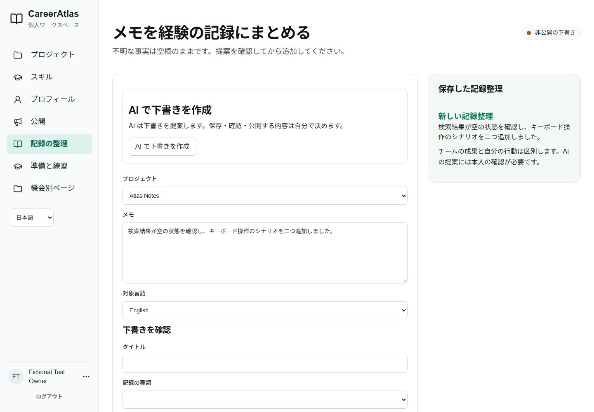
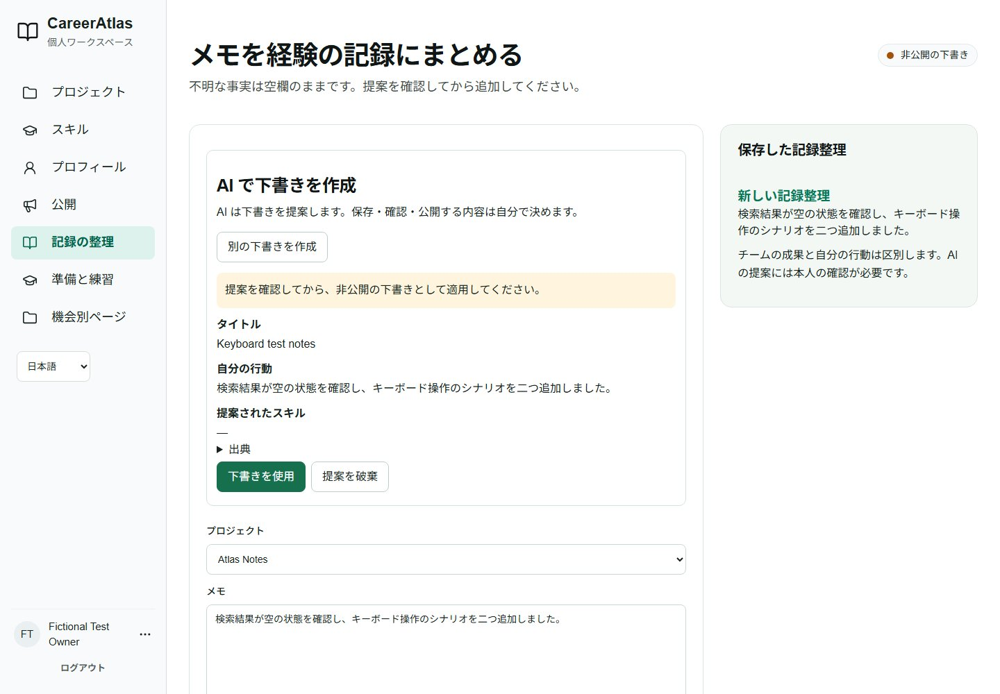
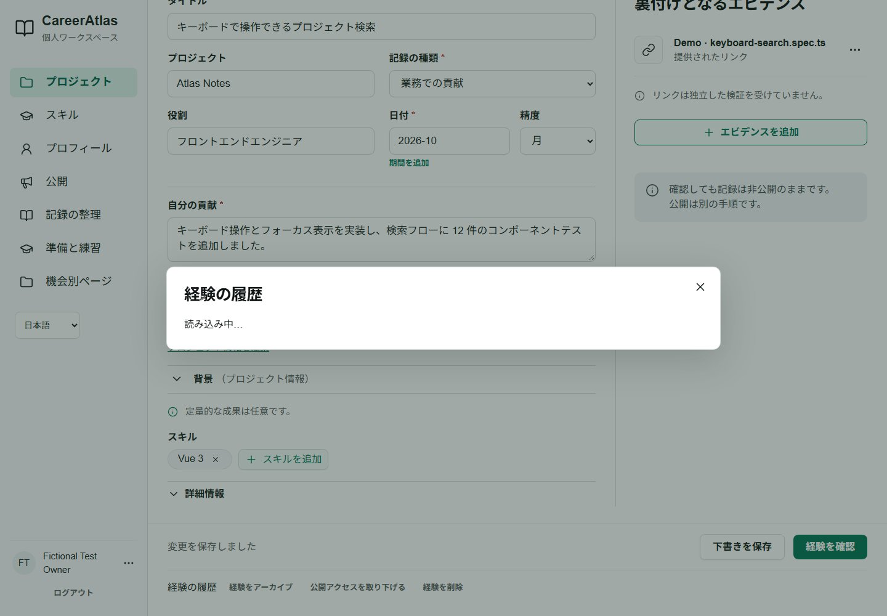

# メモの整理と変更履歴

**記録の整理**では、まず生のメモを保存し、構造化された経験に整理できます。

## メモを保存して整理する

1. プロジェクトを選び、メモを入力して保存します。後から開き直せます。
2. タイトルと個人の行動を手動で入力します。AI が有効なら**AI で下書きを作成**を使い、提案された事実と任意の追加質問を確認して、採用または破棄します。不明な事実は質問として残し、回答をスキップしても構いません。
3. 編集したメモを保存し、**重複候補を確認**で候補を比較します。文章が似ていても、同じ経験とは限りません。
4. **新しい経験として追加**するか、バージョンを確認して指定の経験に統合します。生成された経験を開き、別途確定してください。

AI の提案を適用しても、確定・公開はされません。スキルの提案も確認してから適用します。別の画面で情報源が変更された場合、提案や統合が無効になることがあります。最新の情報源を読み込み、内容を確認し直してください。

*固定出力のテスト提供元で確認操作を示しています。実際のモデルの言語対応や回答品質を示す出力ではありません。*

## 変更を確認する

経験から**経験の履歴**を開くと、バージョンと項目ごとの差分が表示されます。本人専用の画面で、元の事実、後の修正、確定済みバージョンを区別できます。準備した回答には独立した[回答履歴](./preparation.md)があります。

公開ページは選択したバージョンのスナップショットです。記録の編集で共有済みページが自動的に書き換わることはありません。更新を見せるには、再度プレビューを確認して公開します。

AI が無効・キャンセル・失敗の場合も手動編集を続けられます。未適用の提案実行記録は 1 日後に整理され、適用済みの下書きは保存済み記録として残ります。
