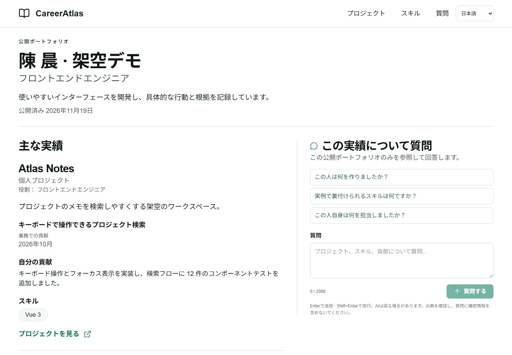

# 経験を、根拠とともに伝える

CareerAtlas は、プロジェクト、個人の貢献、スキル、根拠を結び付けます。同じ非公開の記録を使って面接を準備し、選んだ情報だけをポートフォリオとして公開できます。

**[5 ステップで始める](./quickstart.md)** · **[ローカルで動かす](./development.md)** · **[全機能を見る](./roadmap.md)**

*実際のアプリケーションのスクリーンショットです。このガイドの氏名、記録、プロジェクト、根拠リンクはすべて架空のデモデータです。*

## 目的から探す

| やりたいこと | ガイド |
| --- | --- |
| 自分が行った仕事を記録する | [プロジェクト・経験・スキル・根拠](./records.md) |
| 散らばったメモを経験に整理する | [メモの整理と変更履歴](./capture.md) |
| 面接回答を準備して練習する | [面接準備と文章での練習](./preparation.md) |
| ポートフォリオを公開し、質問に答える | [公開と Q&A](./publishing.md) |
| 応募先に合わせたページを作る | [応募機会と Markdown 出力](./opportunities.md) |
| 何が公開されるか確認する | [プライバシーと AI](./privacy-and-ai.md) |
| 拡張・セルフホストする | [技術構成](./architecture.md)、[開発](./development.md)、[API と MCP](./mcp.md) |

## 3 言語で同じ流れを

アプリと本ガイドは英語、簡体字中国語、日本語に対応しています。言語メニューでは同じ章に切り替えられます。画面の言語、プロフィールの言語、生成する内容の対象言語は別の設定です。画面の言語を変えても、保存済みの経験や過去の回答は翻訳されません。

本ガイドは実装済みの P0/P1 機能を対象とします。[指定相手へのアクセス許可、組織での共同利用、第三者による確認](./roadmap.md)は P2 の計画で、現時点では利用できません。AI の利用可否は運用設定によります。AI がなくても手動の基本操作は利用できます。
