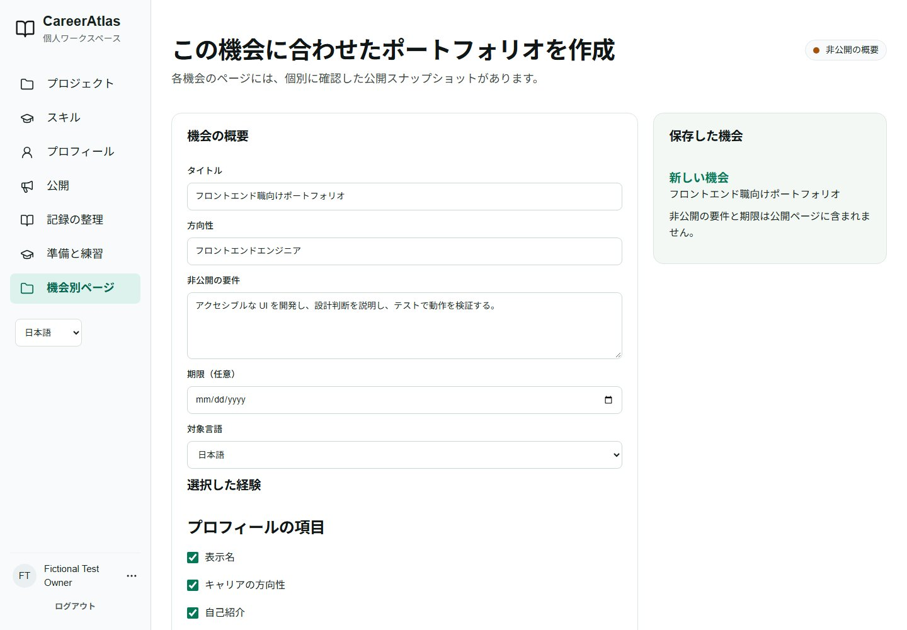

# 応募機会とエクスポート

非公開の経験全体を見せずに、応募や仕事の機会ごとにポートフォリオを作成します。

## 非公開の概要を書く

**機会別ページ**でタイトル、対象分野、要件、任意の期限、対象言語を入力します。確定済み経験と公開項目を選び、順序を調整します。非公開の概要は公開ページに含まれません。

任意の AI 対応付けは関連する根拠と不足を説明します。紹介文では強調点を変えられますが、情報源の事実は変えられません。確認・保存・確定してから紹介文を含めます。AI の下書きの適用だけでは確定になりません。

## 独立したページを公開する

**公開プレビューを確認**し、項目と順序を検証してから**この機会のページを公開**します。公開ページを開いて確認します。各機会は独立した公開・取り消し状態を持ちます。このページのアシスタントから別の応募機会を見つけることはできません。

ページごとに更新・取り消しできます。情報源の変更後は、選択の更新、再確定、新しいプレビューが必要な場合があります。

## Markdown をダウンロードする

**Markdown をダウンロード**すると、許可された選択項目、対象言語の見出し、情報源のバージョン参照が出力されます。翻訳が必要なら、利用可能な場合に翻訳を依頼し、各項目を確認して、情報源と照合したことをチェックしてからダウンロードします。

名前、日付、数字、責任範囲、出典情報を正確に保ってください。現在の出力は Markdown で、PDF や履歴書レイアウトの生成機能ではありません。取り消しは今後のオンラインアクセスと出力に反映されますが、ダウンロード済みのコピーは消せません。受信者指定と有効期限は[計画中](./roadmap.md)です。
