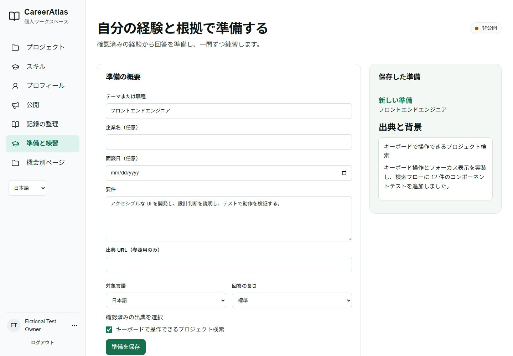
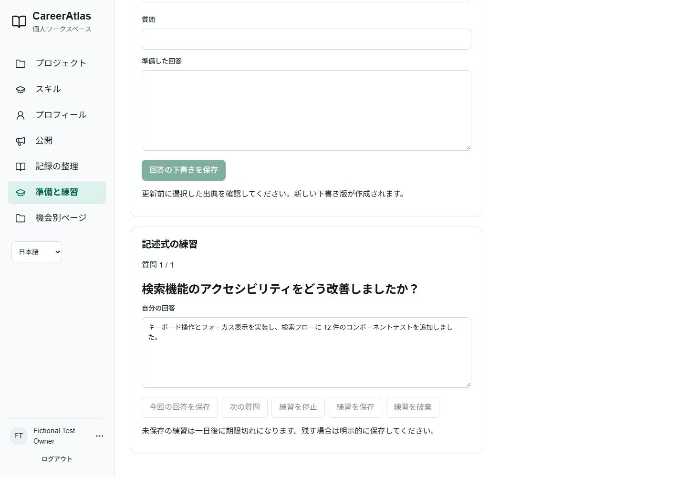

# 面接準備

## 準備用の概要を作る

**準備と練習**で職種またはテーマを入力します。会社、面接日、要件の文章、参照 URL は任意です。URL は参照として保存され、自動取得されません。確定済み経験、対象言語、短めまたは標準の回答長を選び、保存します。

## 回答を作って確定する

質問と回答を手動で入力するか、任意の AI による要件対応付け・回答作成を使います。関連性、引用、不足する情報、追加質問を確認してください。適合率の数字は根拠の代わりにはなりません。自分の担当とチームの成果を分けて説明します。

回答の下書きを保存し、編集後に明示的に確定します。**回答履歴**には各バージョンと当時の情報源が残ります。情報源の変更や利用不可が表示されたら、更新して回答を再確認してから確定します。画面の言語を切り替えても回答は変わりません。生成内容には対象言語が使われます。

## 一問ずつ練習する

1. 練習問題を 1 行に 1 問ずつ入力して開始します。
2. 回答を書いて試行を保存します。修正して再度保存することもできます。
3. 次の質問へ進むか停止します。AI が有効なら、具体性・構成・整合性・明瞭さに関するフィードバックを依頼し、確認してから保持します。
4. **練習を保存**してセッションを残すか、破棄します。フィードバックの保持だけでは練習セッションは保存されません。

保持しなかった練習は 24 時間後に期限切れとなり、定期処理で削除されます。破棄した練習が経験になることはありません。文章による練習であり、録音、発話採点、採用確率、自動採用評価は提供していません。回答長は目安です。

AI は全段階で任意です。利用できない場合も、手動で作成・編集・確定・練習できます。
