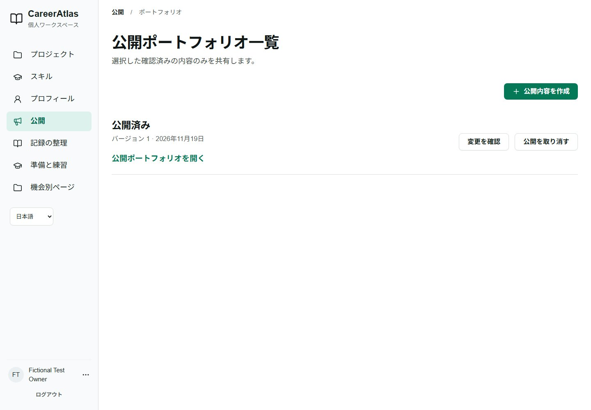
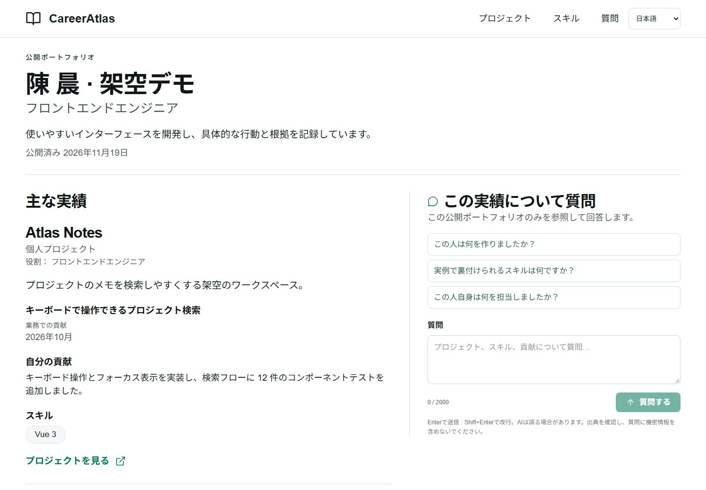
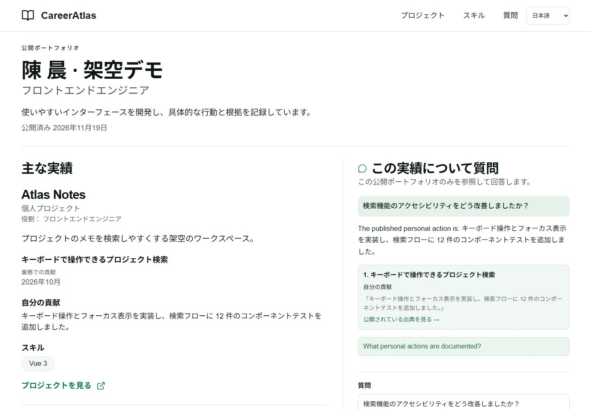

# 公開とポートフォリオ Q&A

## 選択・プレビュー・公開

**公開**には共有可能な確定済み経験が表示されます。プロフィール、プロジェクトの文脈、経験の公開項目を選び、訪問者向けプレビュー全体を確認してから公開します。情報源や選択が変わったらプレビューを更新します。古いプレビューで異なる内容を公開することはできません。

公開ページはスナップショットであり、すべての非公開編集をリアルタイムに反映するものではありません。下書き、非公開メモ、未選択項目、別の応募機会は入りません。有効な公開リンクを持つ人は閲覧できます。推測しにくい URL は指定相手へのアクセス制御にはなりません。

## 閲覧して質問する

訪問者はアカウントなしでプロフィール、プロジェクト、貢献、スキル、根拠を読めます。詳細画面には、そのページで選んだ情報だけが表示されます。

Q&A が有効なら、アシスタントは現在の公開ページで許可された情報源だけを使います。経験に関する事実にはクリックできる引用が付き、情報源の文脈を確認できる必要があります。不明な情報は不明と示します。非公開の記録について質問しても、閲覧権限は広がりません。

実行中のリクエストはキャンセルできます。提供元の障害や回数制限があっても手動で閲覧できます。公開 Q&A は質問の言語に従い、過去の回答や本人が入力した文章は自動翻訳されません。

*固定出力のテスト提供元で非同期の回答と引用の流れを示しています。実際のモデル品質や翻訳を評価するものではありません。*

## 更新・取り消し

新しいプレビューを確認し、明示的に公開して更新を共有します。**公開を取り消す**はオンラインページとそのアシスタントへのアクセスを停止します。情報源の撤回でも、依存する内容の継続表示を防ぎます。ワークスペースのアーカイブだけでは公開は取り消されません。

ダウンロード・コピー済みの内容は回収できません。応募先ごとに[独立したページ](./opportunities.md)を作成できます。本人認証を伴う受信者指定は今後の計画です。
