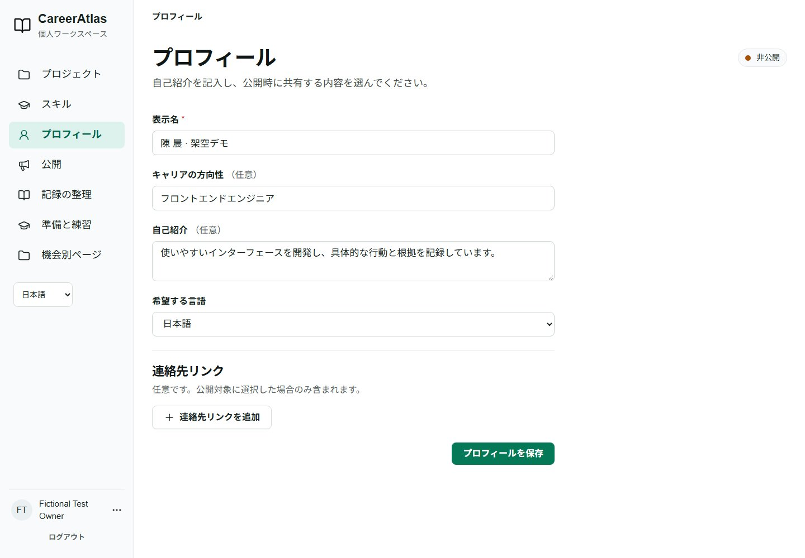

# クイックスタート

根拠のある貢献を一つ公開するまでの流れです。AI の設定は必要ありません。

## 1. ログインしてプロフィールを設定する

製品ホームから**ログイン**を選び、必要なら**アカウントを作成**に進みます。表示名、メールアドレス、12 文字以上で確認欄と一致するパスワードが必要です。ホームとドキュメントは公開されていますが、ワークスペースにはログインが必要です。

**プロフィール**で表示名を保存し、必要に応じて方向性、自己紹介、連絡先リンク、希望する内容の言語を設定します。連絡先の保存だけでは公開されません。

## 2. プロジェクトを作成する

**プロジェクト**でタイトル、種類、自分の役割を入力します。背景、期間、チームの成果も追加できます。概算の日付や進行中のプロジェクトにも対応しています。

## 3. 自分の貢献を記録する

プロジェクトに経験を追加し、タイトル、記録の種類、発生時期、**自分の行動**を入力します。スキルとラベル付きの根拠リンクを関連付けます。不完全な情報は下書きで保存し、事実を確認してから**経験を確認**します。自分の行動とチーム全体の成果を分けて記録してください。

## 4. 選択した項目をプレビューする

**公開**で確定済みの経験と、公開するプロフィール・プロジェクト・経験の項目を選びます。訪問者向けプレビューを確認します。未選択の項目と非公開メモは公開ページに入りません。

## 5. 公開して確認する

明示的に公開操作を行い、公開リンクを開いて内容を確認します。訪問者はログイン不要で閲覧できます。運用者が有効にしていれば Q&A も利用できます。公開を終了するときは取り消します。

次は[面接回答の準備](./preparation.md)、または[応募機会別ページの作成](./opportunities.md)に進んでください。ボタンが見つからない場合や保存できない場合は[トラブルシューティング](./troubleshooting.md)を参照してください。
