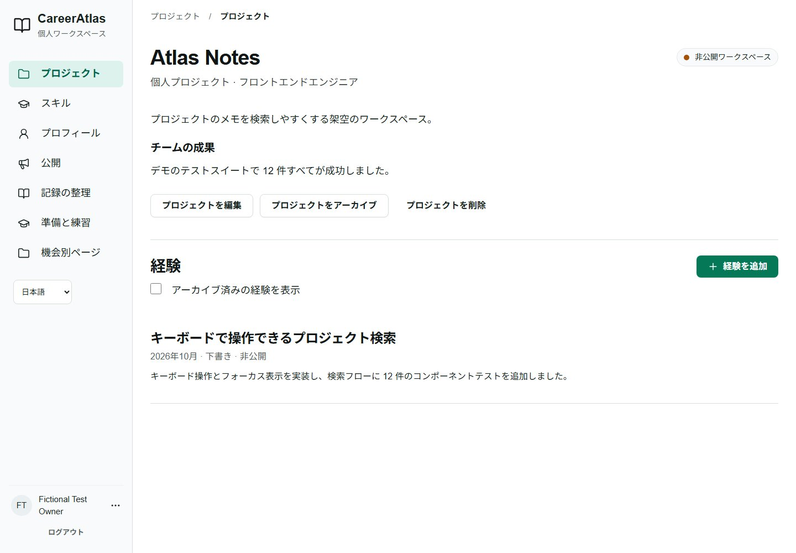
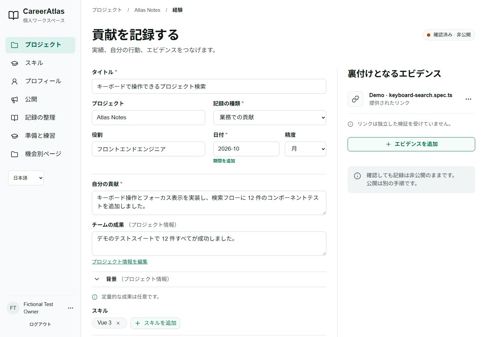
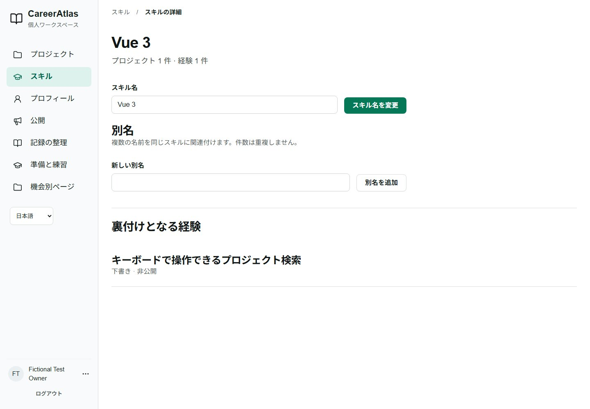

# プロジェクトと経験

## プロフィールとプロジェクト

**プロフィール**には表示名、方向性、自己紹介、連絡先リンク、希望言語を保存します。**プロジェクト**では商用・個人・学習の仕事をまとめます。タイトル、種類、役割は必須です。背景、期間、チームの成果で文脈を補えます。一覧を検索し、プロジェクトを開いて経験を管理します。

## 経験のライフサイクル

1. プロジェクト内に記録を作成します。不完全な情報は下書きで保存できます。
2. 自分の行動、結果、検証方法、残っている作業を記録します。日付は年・月・日単位に対応し、正確でない日付を作る必要はありません。
3. スキルと根拠を追加し、確認して確定します。タイトル、プロジェクト、記録の種類、発生時期、個人の行動が必要です。
4. 事実が変わったら編集します。保存バージョンと確定状態によって公開可否が決まります。更新した下書きを確定し、新しい公開プレビューを確認します。

**自分の行動**は自分が行ったこと、**チームの成果**はチーム全体の結果です。チームの成果だけで、すべてを自分が担当したとは言えません。**非公開メモ**は本人専用で、公開内容には含まれません。

アーカイブと復元はワークスペースの整理に使います。アーカイブだけでは公開の取り消しになりません。削除や情報源の撤回によって、依存する公開内容が利用できなくなる場合があります。操作前に確認ダイアログを読んでください。[変更履歴](./capture.md)で記録の変化を確認できます。

## スキルと別名

スキルを作成し、経験との関連付け・解除を行います。スキルの詳細から関連する仕事を確認できます。名前の変更や別名の追加・削除で表記を整理します。経験数とプロジェクト数は重複を除いて数えます。公開ページの件数は、そのページで許可された情報だけが対象です。

## 根拠

リポジトリやデモなど、種類とラベルを付けた URL を登録します。リンクの提供は独立した検証を意味しません。リンク先は自動取得・実行されません。本人の説明と将来の第三者による確認を同一視しないでください。経験内で根拠を編集・削除し、情報源が変わったら公開プレビューを再確認します。
