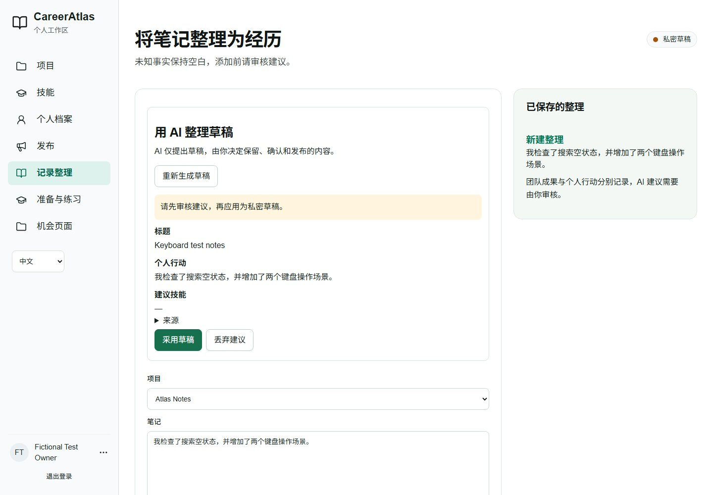
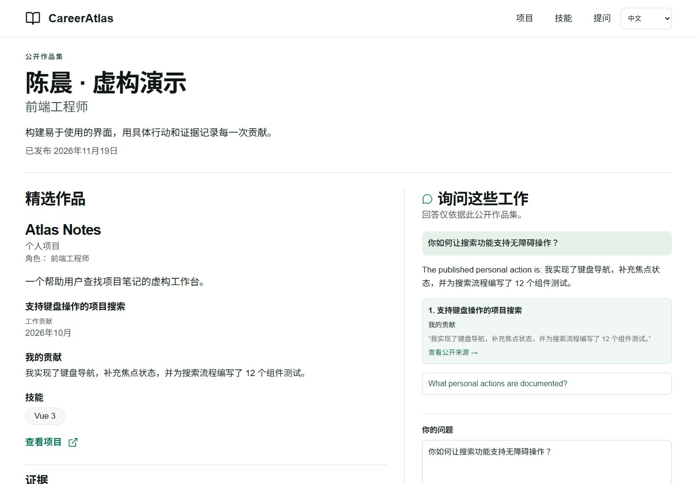

# AI Agent 上手教程

**把笔记整理成职业故事，再让访客通过对话了解背后的证据。** CareerAtlas 提供面向本人的 AI 辅助，以及独立的、带来源引用的作品集问答 Agent。

## 选择你的起点

| 你想做什么 | 从哪里进入 | Agent 如何帮助你 |
| --- | --- | --- |
| 整理一项贡献 | **记录整理** → **用 AI 整理草稿** | 建议可编辑的事实与可选追问 |
| 准备面试 | **准备与练习** → 选择来源 → AI 操作 | 映射要求、起草回答、反馈文字练习 |
| 定制求职材料 | **机会页面** → AI 操作 | 映射证据、起草简介或提供待审核的导出译文 |
| 了解作品集 | 公开页面 → **你的问题** | 在当前发布范围内回答，并引用支持记录 |

新账号请先完成[首次使用设置](./quickstart.md)。AI 控件仅在运营者为对应用户或公开页面启用后可用，两者分别控制。自行运行时的配置见[本地开发](./development.md)。

## 1. 和 Agent 一起整理经历

1. 登录并创建项目，进入**记录整理**，选择所属项目。
2. 在**笔记**中填写事实并保存。例如：“我为项目搜索增加了键盘导航，并编写了 12 个组件测试。”创建真实记录时请使用自己的事实。
3. 点击**用 AI 整理草稿**，核对建议的标题、个人行动、来源和追问；补充缺失事实，无法回答的问题可以跳过。
4. 点击**采用草稿**，编辑字段后保存。检查可能重复的记录，再决定添加或合并经历。
5. 打开生成的经历，关联相关技能和证据，由你明确确认。应用建议不等于确认记录。

*实际应用界面，使用虚构数据与固定输出的测试草稿，展示审核和应用流程，不代表真实模型质量。*

## 2. 根据证据准备回答

在**准备与练习**中填写主题和要求，选择已确认经历及目标内容语言。先保存简报，再请求 AI 辅助。检查要求与证据的对应关系，然后输入“你亲自做出了哪些贡献？”等问题，生成回答草稿。

核对回答是否保留了你的职责、行动、结果及来源引用。应用到编辑器后修改、保存，并自行确认。文字练习中，先保存作答，再请求反馈；保留反馈与保留练习会话是两个独立操作。[完整准备流程](./preparation.md)。

为某个机会起草简介或翻译导出内容时，同样遵循**选择来源 → 生成 → 核对 → 明确应用**。下载译文前，逐项对照来源检查。[机会与导出](./opportunities.md)。

## 3. 让访客向作品集 Agent 提问

选择已确认记录与公开字段，核对预览后发布。打开公开页面，访客无需账号。启用公开问答后：

1. 选择建议问题，或在**你的问题**中输入“这个人做过什么？”等问题。
2. 发送问题并阅读回答。进行中的请求可以取消。
3. 点击引用查看支持该回答的来源。Agent 只能读取当前页面允许的记录，缺少证据时应明确说明。

*图中回答由固定输出的测试提供方生成，示例措辞用于展示引用流程，不用于评价语言效果或真实模型表现。*

公开问答跟随提问语言，本人草稿和导出译文使用所选内容语言。切换界面语言不会翻译已保存记录或历史回答。

## 核对、重试，或继续手动操作

由你决定保留、确认和发布哪些事实，Agent 不会替你发布或发送求职申请。来源变化后，刷新来源并检查新的建议。AI 不可用或请求被取消时，可以继续手动编辑或阅读。

本教程介绍产品中的 AI 功能。开发者 MCP 是独立的已认证集成，见 [API 与 MCP](./mcp.md)。每类 Agent 可以访问哪些信息，详见[隐私与来源边界](./privacy-and-ai.md)。
