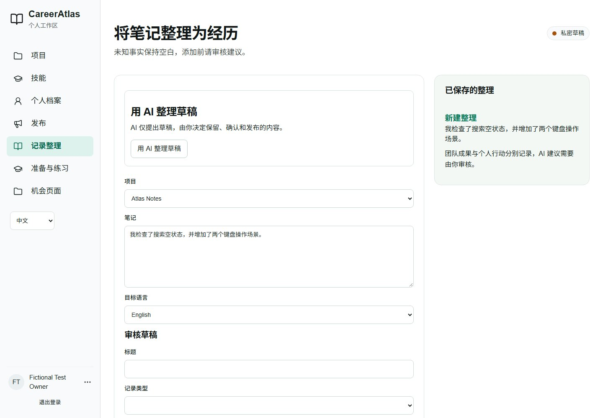
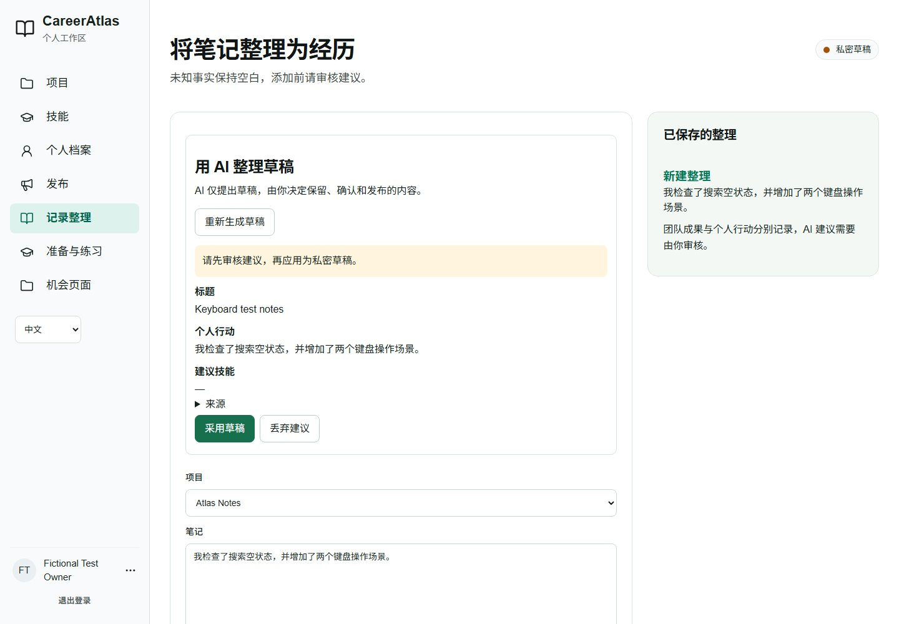
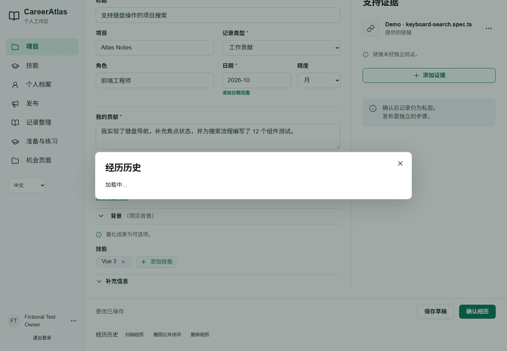

# 素材采集与修订历史

使用**记录整理**先保存原始笔记，再整理为结构化经历。

## 保存和整理笔记

1. 选择项目，输入笔记并保存，之后可以重新打开。
2. 手动填写结构化标题和个人行动。AI 可用时点击**用 AI 整理草稿**，检查建议事实和可选追问，再使用或丢弃草稿。缺少的事实应保留为问题，也可以跳过。
3. 保存编辑后的笔记，点击**检查重复记录**并比较候选记录。内容相似不代表一定是同一条经历。
4. 选择**添加为新经历**，或者核对版本后合并到指定经历。打开生成的经历，单独完成确认。

应用 AI 建议不会自动确认或发布。建议关联的技能也需要你检查后应用。如果另一个页面修改了来源，建议或合并操作可能失效；应重新加载当前来源并核对，避免覆盖新修改。

*此截图使用固定输出的测试提供方演示检查控件，示例输出不代表真实模型的语言或回答质量。*

## 查看变化

在经历中点击**经历历史**，查看各版本和字段差异。这是仅本人可见的视图，用于区分原始事实、后续修正和已确认版本。准备好的回答也有独立的[回答历史](./preparation.md)。

公开页面使用选定版本的快照，编辑记录不会悄悄改写已经分享的页面。希望访客看到更新时，需要重新预览并发布。

AI 被关闭、取消或失败时仍可以手动编辑。未应用的 AI 建议运行记录会在一天后清理，已经应用的草稿作为正式保存的记录保留。
