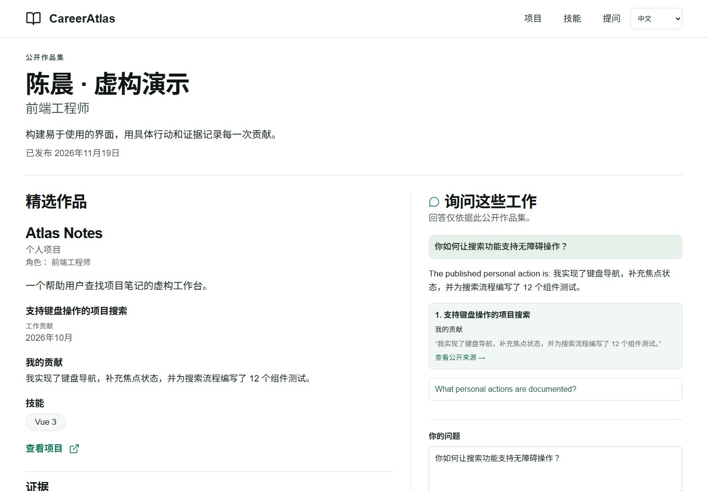

# 用 AI Agent 讲好有据可循的职业故事

CareerAtlas 的 **AI Agent** 帮你将笔记整理为经历草稿，准备有来源支持的面试回答，并通过带引用的问答向访客介绍作品集。项目、个人贡献、技能与证据共同构成对话的事实基础。

**技术栈：** PHP 8.3+（**Laravel 13 后端框架**）· Vue 3 · TypeScript · PostgreSQL。

**[开始使用 AI Agent](./ai-agent.md)** · **[首次使用设置](./quickstart.md)** · **[本地运行](./development.md)**

## 两条 Agent 使用主线

- **面向本人**：整理可编辑草稿、映射要求与证据、准备回答、反馈练习，以及起草简介或导出译文。
- **面向访客**：通过问答了解已发布的作品集，点击引用查看选定来源的上下文。

**由你选择来源并审核结果。** Agent 不会替你确认或发布。AI 是否可用取决于运营配置，手动流程始终保留。

*实际应用界面，使用虚构演示数据。图中回答由固定输出的测试提供方生成，用于展示引用流程，不代表真实模型质量。*

## 从你的任务开始

| 我想…… | 阅读指南 |
| --- | --- |
| 从整理笔记到引用问答体验 AI Agent | [AI Agent 上手教程](./ai-agent.md) |
| 记录自己做过的工作 | [项目、经历、技能与证据](./records.md) |
| 把零散笔记整理成经历 | [素材采集与修订历史](./capture.md) |
| 准备并练习面试回答 | [面试准备与文字练习](./preparation.md) |
| 分享作品集并回答访客问题 | [发布与问答](./publishing.md) |
| 为某次应聘定制页面 | [机会与 Markdown 导出](./opportunities.md) |
| 了解哪些信息会公开 | [隐私与 AI 边界](./privacy-and-ai.md) |
| 扩展或自行部署应用 | [技术架构](./architecture.md)、[开发指南](./development.md)、[API 与 MCP](./mcp.md) |

## 三种语言，同一套流程

应用与本指南支持英语、简体中文和日语。文档的语言菜单可切换当前章节。界面语言、个人资料语言和生成内容的目标语言是独立设置；切换界面不会翻译已保存的经历或历史回答。

本指南覆盖已实现的 P0/P1 功能。[指定接收人授权、组织协作与他人确认](./roadmap.md) 属于规划中的 P2，目前没有对应的可用操作。AI 是否可用取决于运营配置；没有 AI 时仍可手动完成核心流程。
