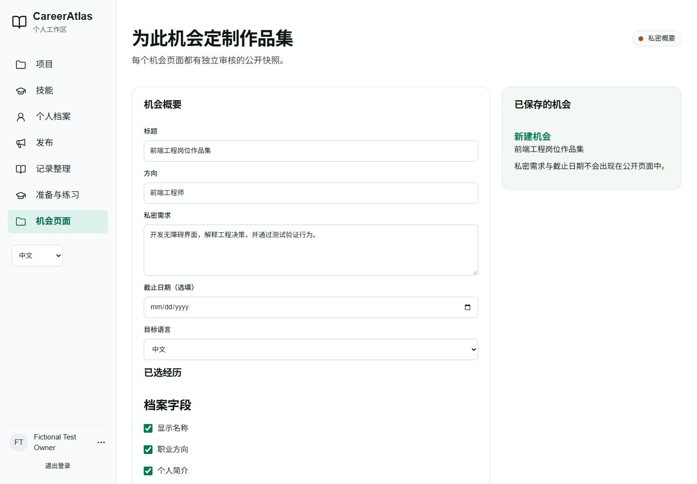
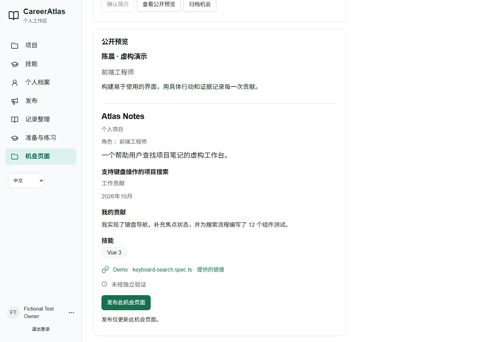

# 机会与导出

为每次应聘或职业机会单独组织作品集，无需暴露整个私人经历库。

## 编写私人简报

在**机会页面**中填写标题、目标方向、要求、可选截止日期及目标语言。选择并排序已确认经历及其公开字段。私人简报不会进入公开页面。

可选的 AI 要求映射用于解释相关证据和缺口。简介可以调整表达重点，但必须保留来源事实。检查、保存并确认简介后才能将其包含在页面中；应用 AI 草稿本身不等于确认。

## 发布独立页面

点击**查看公开预览**，核对字段和排列顺序，再**发布此机会页面**。打开公开页面检查结果。每个机会有独立的发布与撤销流程；访客不能通过本页面的助手发现其他机会。

可以单独更新或撤销某个页面。来源变化后，可能需要刷新选择、重新确认并生成新的预览。

## 下载 Markdown

通过**下载 Markdown**导出允许公开的所选字段，包含本地化标题和来源版本引用。需要翻译时，在功能可用的情况下请求导出翻译，逐项核对译文，再勾选已对照来源检查的确认框后下载。

姓名、日期、数字、职责和来源信息必须保持准确。目前导出格式为 Markdown，不是 PDF 或简历排版生成器。撤销会影响后续在线访问和导出，但不能删除已下载副本。指定接收人与链接有效期属于[规划功能](./roadmap.md)。
