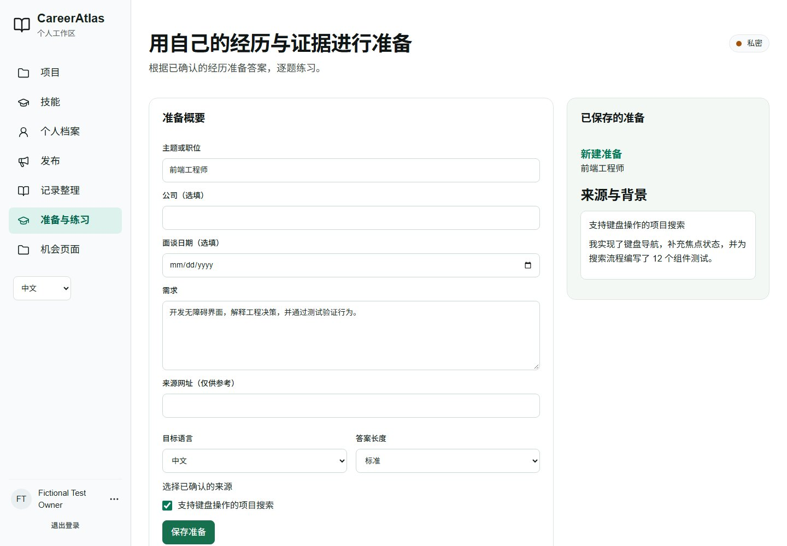
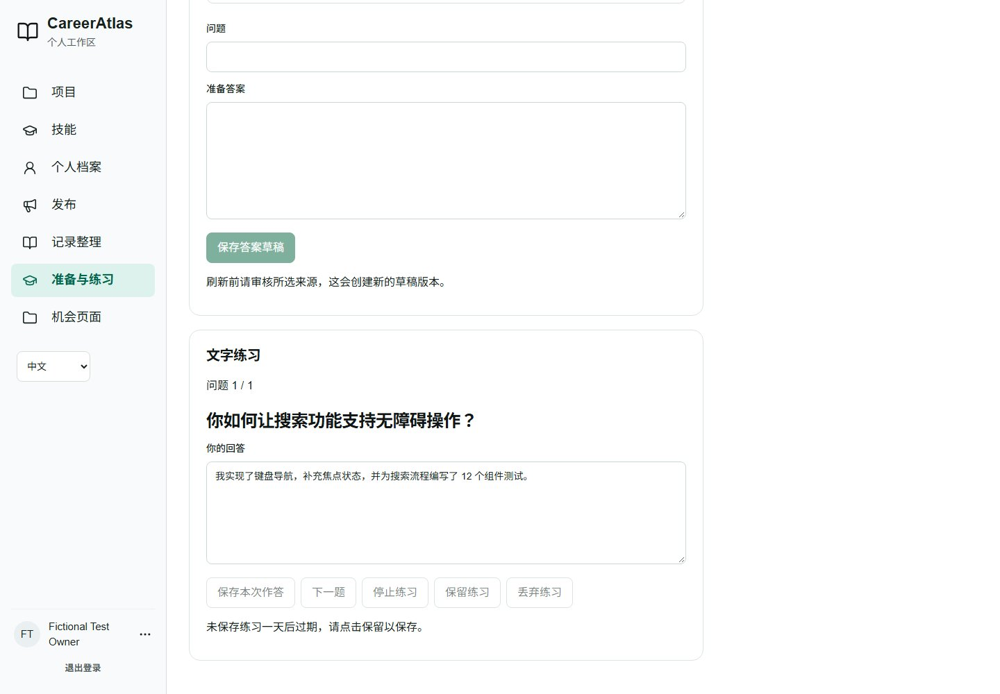

# 面试准备

## 创建准备简报

打开**准备与练习**，填写岗位或主题，可补充公司、面试日期、要求文本和来源 URL。URL 仅作为参考保存，不会自动抓取。选择已确认经历、目标语言以及简短或标准回答长度，然后保存。

## 编写并确认回答

输入问题并自行回答，也可以使用可选的 AI 要求映射和回答起草功能。核对相关性、来源引用、缺口与追问；匹配百分比不能代替证据。始终区分个人职责与团队成果。

先保存回答草稿，编辑后明确确认。**答案历史**保留不同版本及原始来源引用。来源发生变化或不可用时会显示提示；刷新来源、检查回答后再确认。切换界面语言不会改写回答，生成内容使用所选目标语言。

## 一次练习一个问题

1. 输入练习问题，每行一个，然后开始。
2. 输入回答并保存本次作答，也可以修改后再次保存。
3. 切换下一题或停止。AI 可用时，可获取关于具体程度、结构、一致性和清晰度的反馈，检查后再保留。
4. 明确选择**保留练习**以长期保存，或者丢弃。仅保留反馈不会同时保留练习会话。

未保留的练习在 24 小时后过期，并由定时任务清理；丢弃的练习不会成为经历。这是文字练习，不提供录音、语音评分、录用概率或自动招聘评价。回答长度仅为大致指引。

整个流程的 AI 都是可选项，无法使用辅助功能时仍可手动起草、编辑、确认和练习。
