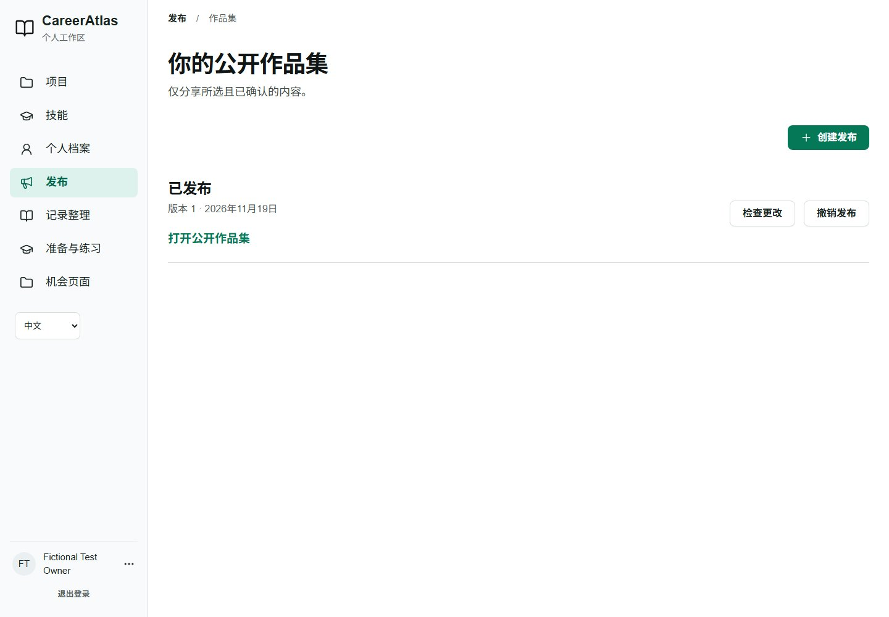
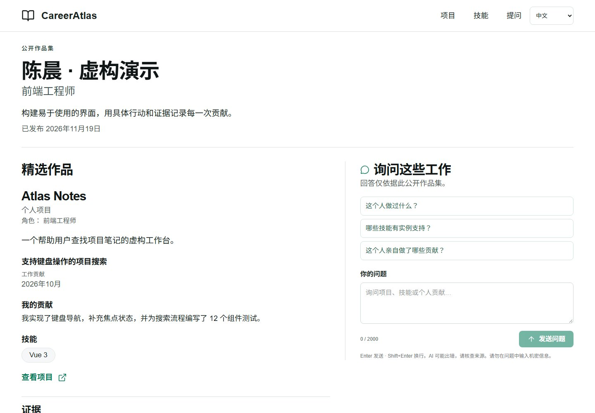
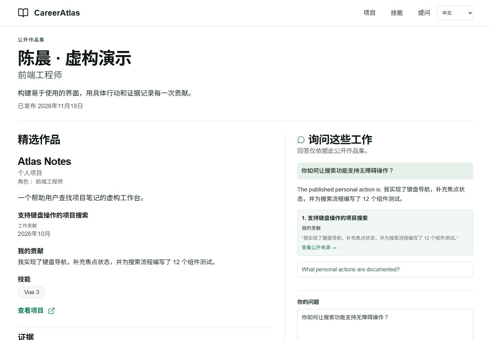

# 发布与作品集问答

## 选择、预览、发布

**发布**页面列出可分享的已确认经历。逐项选择个人资料字段、项目背景和经历字段，检查完整访客预览后再发布。来源或选择发生变化时，需要刷新预览；旧预览不能授权发布不同的内容。

公开页面是快照，不会实时同步所有私人编辑。草稿、私人笔记、未选择字段和无关机会不会进入公开内容。持有有效公开链接的人都可以阅读；难以猜测的 URL 不等于指定接收人授权。

## 阅读和提问

访客无需账号即可浏览个人资料、项目、贡献、技能与证据。项目和技能详情仅展示当前页面选中的内容。

启用问答后，助手仅根据当前公开页面允许的来源回答。关于经历的事实陈述应带有可点击的引用，打开后可以查看来源上下文；缺失信息应明确说明。询问隐藏记录不会扩大页面的访问权限。

访客可以取消进行中的请求。提供方失败或触发频率限制时，仍可以手动阅读。公开问答跟随提问语言；历史回答和用户自己填写的内容不会自动翻译。

*固定输出的测试提供方用于演示异步问答和引用流程；示例措辞不用于评价真实模型质量或翻译效果。*

## 更新或撤回

重新生成并检查预览，明确发布后才会分享更新。**撤销**会停用在线页面及其助手访问。撤回来源也会阻止依赖内容继续展示。仅在工作区归档不能撤销公开页面。

已下载或复制的内容无法追回。面向不同应聘场景可使用[独立机会页面](./opportunities.md)，需要身份验证的接收人授权仍在规划中。
