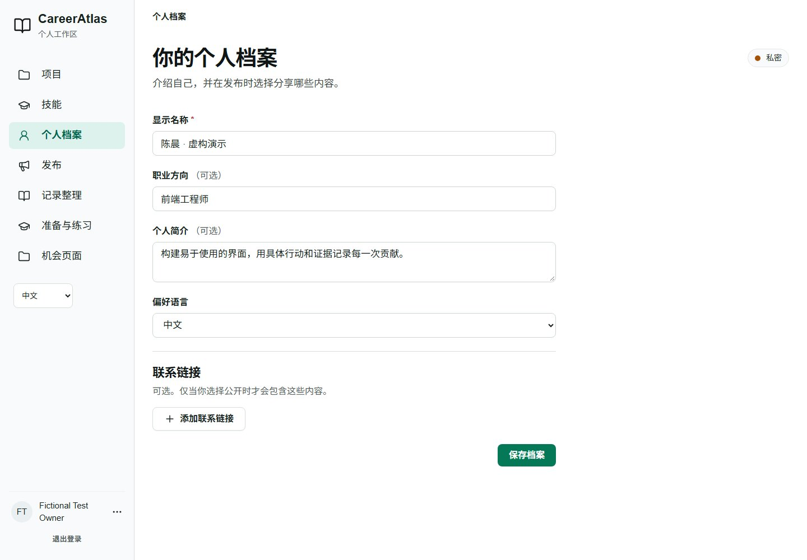

# 快速上手

按以下步骤发布一条有证据支持的个人贡献，无需配置 AI。

## 1. 登录并填写个人资料

从产品首页点击**登录**。没有账号时选择**创建账号**，填写显示名称、邮箱，以及至少 12 个字符且两次输入一致的密码。首页与文档无需登录，工作区需要登录会话。

打开**个人档案**，保存显示名称，可补充发展方向、简介、联系链接和首选内容语言。保存联系链接不代表自动公开。

## 2. 创建项目

在**项目**中填写标题、项目类型和你的角色，可补充背景、日期和团队成果。支持不精确日期及进行中的项目。

## 3. 记录个人贡献

在项目下添加经历，填写标题、记录类型、发生时间和**个人行动**，关联技能与带标签的证据链接。信息不完整时先保存草稿；核对事实后再**确认经历**。将自己的行动与团队整体成果分开记录。

## 4. 预览选定字段

打开**发布**，选择已确认经历，以及打算分享的个人资料、项目和经历字段。检查访客预览；未选择字段和私人笔记不会进入公开页面。

## 5. 发布并检查

明确点击发布，打开公开链接检查内容。访客无需登录即可阅读；运营方启用后可以使用问答。需要停止公开时撤销发布。

下一步：[准备面试回答](./preparation.md)，或[为某个机会定制页面](./opportunities.md)。找不到按钮或保存失败时，查看[常见问题](./troubleshooting.md)。
