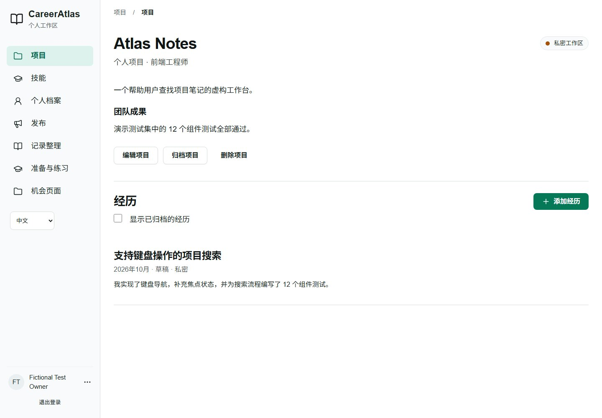
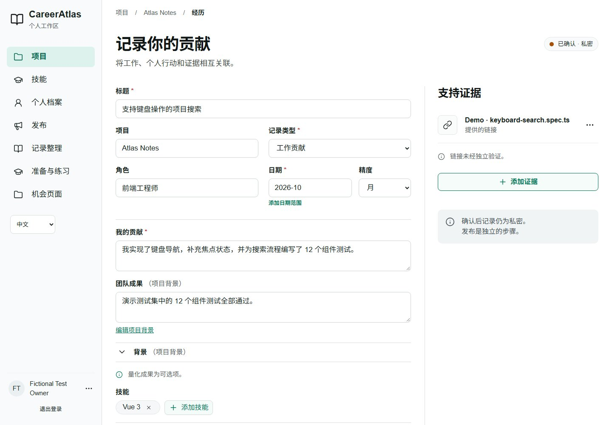
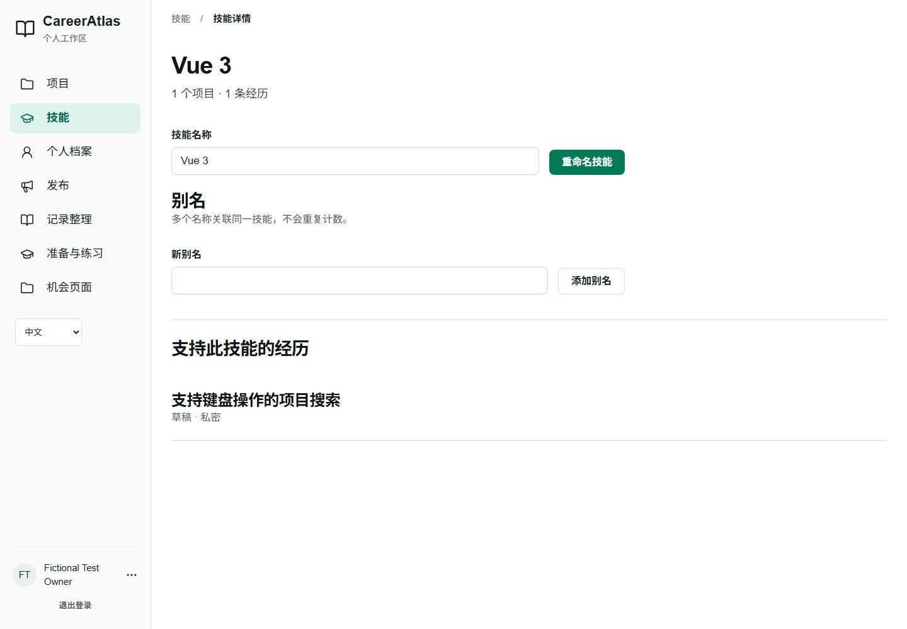

# 项目与经历

## 个人资料和项目

**个人档案**保存显示名称、发展方向、简介、联系链接和首选语言。**项目**用于归纳相关工作，类型包括商业、个人和学习项目。标题、类型和角色为必填项；背景、日期及团队成果用于补充上下文。可以搜索项目列表，进入项目后管理其经历。

## 经历的生命周期

1. 在项目中创建记录；资料不完整时可以保存草稿。
2. 填写个人行动、结果、验证方式和未完成工作。日期支持年、月、日精度，不必编造精确日期。
3. 关联技能与证据，核对后确认。确认需要标题、所属项目、记录类型、发生时间和个人行动。
4. 事实变化后编辑记录；保存版本与确认状态决定是否可发布。确认更新后的草稿，再查看新的发布预览。

**个人行动**说明你做了什么；**团队成果**说明团队整体取得的结果，不能证明你独立完成了所有部分。**私密笔记**仅本人可见，不会进入公开内容。

归档和恢复用于整理工作区，归档不能代替撤销发布。删除或撤回来源可能使依赖该来源的公开内容不可用，操作前请阅读确认弹窗。[修订历史](./capture.md)保留记录的变化。

## 技能与别名

创建技能，在经历中关联或解除关联，进入技能详情查看相关工作。可以重命名技能、添加或删除别名，统一不同写法。经历数与项目数会去重；公开页面的统计仅包含该页面允许展示的内容，不泄露私人经历库的数量。

## 证据

添加带类型和标签的 URL，例如代码仓库或演示链接。提供链接不等于经过独立验证；系统不会自动抓取或执行链接内容。本人陈述与未来的他人确认不能混为一谈。在经历中编辑或删除证据，来源变化后重新检查公开预览。
